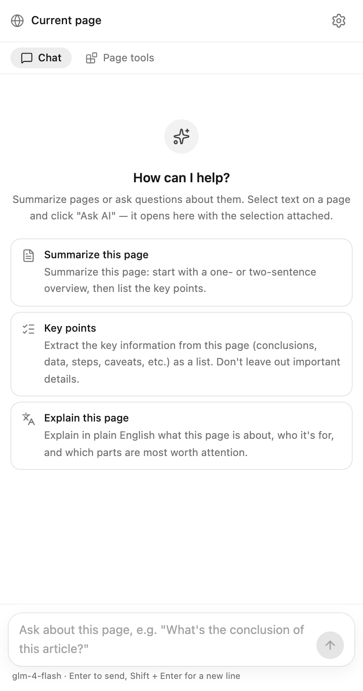
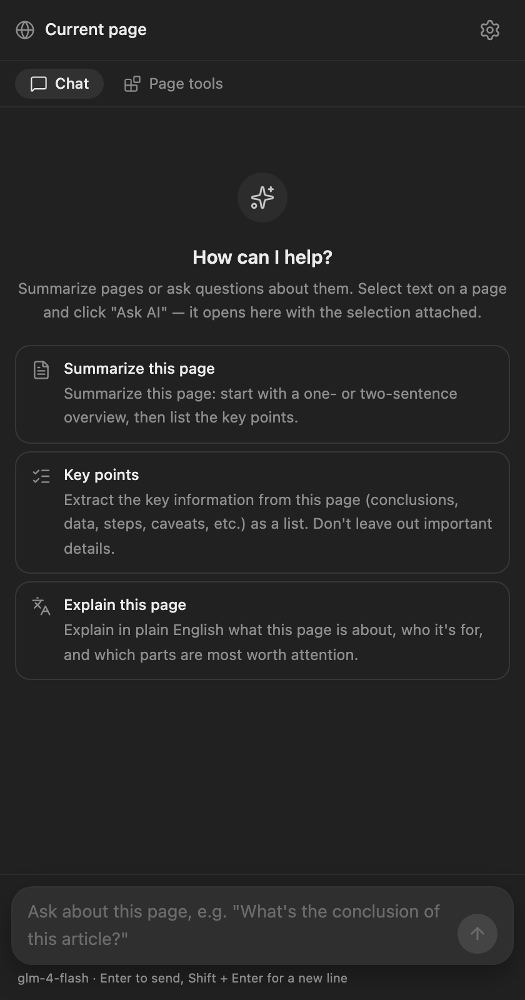

# AI assistant

<!-- Applies to v0.2.3 -->

In one line: a side panel AI assistant (`Alt+2` to open / close) that summarizes the page, extracts key points, and answers questions about it — it reads the page content itself. "Ask AI" from the selection toolbar brings your selection here too.

## Opening it

- Shortcut `Alt+2` (`⌥2` on macOS); press again to close
- Popup's Features page → AI assistant → "Open"
- Floating dock → "AI assistant" or "AI summary"

::: warning
`Alt+2` is Chrome-only; Firefox controls side panels itself — open it from the popup or the floating dock there.
:::

## Quick actions

Three quick actions sit at the top of the panel, each preloaded with the current page:

| Action              | What it does                                                 |
| ------------------- | ------------------------------------------------------------ |
| Summarize this page | One- or two-sentence overview, then the key points           |
| Key points          | Conclusions, data, steps, caveats — as a list                |
| Explain this page   | What the page is about, who it's for, what's worth attention |

## Chatting

- The assistant reads the current page's content itself (including Shadow DOM pages) — no copy-pasting
- Answers stream in; expand **reasoning** to see the thinking
- "Ask AI" from the selection toolbar brings the selection in as a quote; remove it above the input box
- When the page provides WebMCP tools, or you've added [site tools](/en/features/site-tools) for the site, the AI can call them and act on the page (see [Page tools](/en/features/webmcp)); runs show up as cards in the conversation
- Say "make a search tool for this site" and the AI inspects the page, test-runs, and builds a site tool for you
- Answers render Markdown: headings, lists, code blocks, tables and more

Input box: `Enter` to send, `Shift + Enter` for a newline; click "Stop" while generating.

_The side panel assistant: quick actions on top, chat about the current page below._

_The side panel in dark theme._

## Model configuration

The assistant uses the [chat model](/en/settings/models) (configured separately from the translation model) — pick a strong model with tool calling. "Settings" at the top right of the panel jumps to the config, where you can also append custom instructions (e.g. "keep answers short").

## Notes

- Without a model, the input box says "Configure a chat model in settings first"
- Browser built-in pages (`chrome://` URLs) can't be read; pages opened before DevGo was installed or updated are handled automatically, no refresh needed
