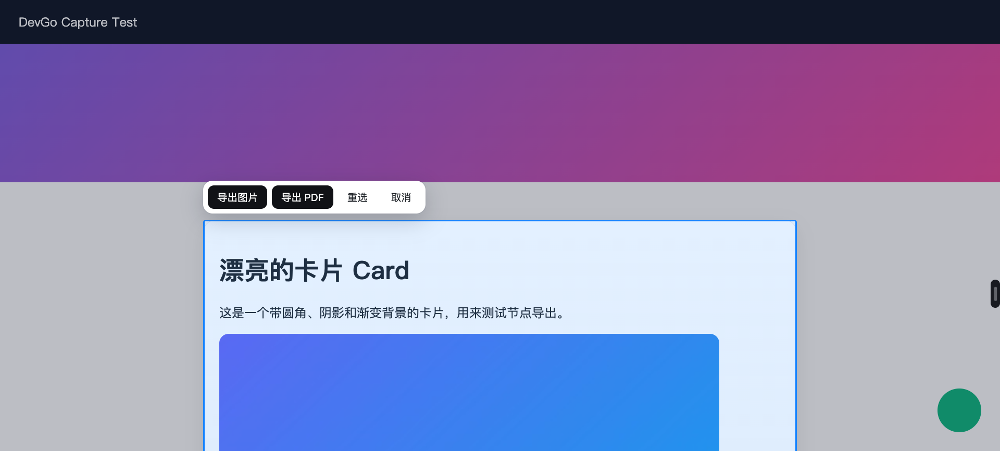

# Page export (PDF / image)

<!-- Applies to v0.2.5 -->

In one line: export the current page as a PDF or long image that looks exactly like it does on screen — styles and images intact — or pick one part of the page and export just that.

## Using it

Open the page, click the toolbar icon to open the popup, switch to the Features tab, and find "Export page":

| Button          | What it does                                                                                                         |
| --------------- | -------------------------------------------------------------------------------------------------------------------- |
| **Page PDF**    | Scrolls through the whole page and stitches it into a PDF. Text in the PDF can be selected, copied and searched      |
| **Page image**  | Captures the whole page the same way and saves it as one long PNG                                                    |
| **Select area** | The popup closes; pick a block on the page (a card, a table, a section) and export it as an image or PDF — see below |

Files go straight to the browser's download folder, and the popup shows the file name. The page's right-click menu also has "Export page as PDF" and "Export a page area as image / PDF".

## Exporting a selected area

After clicking "Select area":

1. Move the mouse over the page — a blue box highlights the element under the cursor and shows its size
2. Picked too small or too large? Press **↑** for the parent element and **↓** to go back to the child
3. Click to lock it and a toolbar appears: **Export image** / **Export PDF** / **Pick again** / **Cancel**; **Esc** exits at any time

You get the element's **full content**, not just the part visible on screen: elements taller than the window are scrolled through in segments and stitched together.

_Selecting an area: once the card is locked, the export toolbar appears (screenshot shows the Chinese UI)._

## How is this different from "Print to PDF"?

The browser's print dialog re-lays the page out for paper, often dropping backgrounds, shifting elements, or splitting the page awkwardly. DevGo captures the page exactly as it's rendered on screen:

- Background colors, gradients, images, rounded corners and shadows are kept
- Sticky headers and floating buttons appear only once, at the top, instead of repeating on every segment
- DevGo's own UI (the dock, the selection toolbar) never shows up in the export
- Full-page PDFs carry an invisible text layer, so text can be selected, copied and searched

## Notes

- Browser built-in pages (`chrome://` URLs) and the extension store don't allow screenshots; the buttons say the page isn't supported
- Very long pages take a few seconds to a few tens of seconds while the page scrolls automatically — stay on the tab until it finishes
- Infinite-scroll feeds can only be exported as far as they've loaded
- No extra permissions are required
