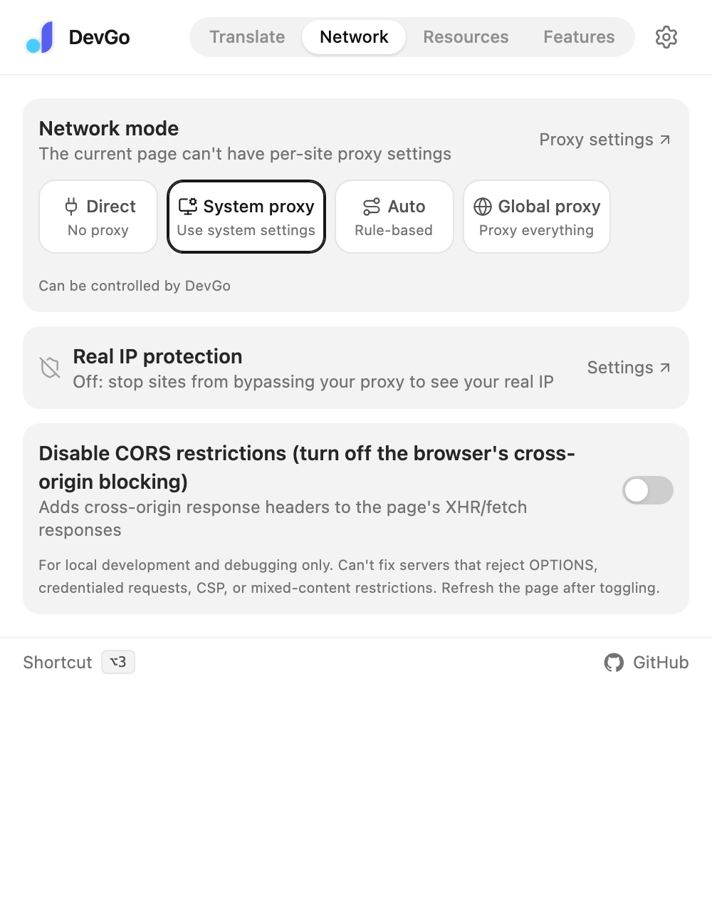

# CORS debugging

<!-- Applies to v0.2.3 -->

In one line: a toggle that adds cross-origin response headers to the page's XHR / fetch responses — convenient for local development.

## When you need it

The classic local-dev error: your frontend on `localhost:5173` requests an API on another domain, and the browser blocks the response because it's missing `Access-Control-Allow-Origin`. The request actually succeeded — the page just can't read it.

Flip this switch and DevGo adds the missing CORS headers to the page's XHR / fetch responses. The frontend works without code changes or a dev proxy — unblock yourself first, fix the server later.

## How to enable

Popup's Network page → "Disable CORS restrictions". **Refresh the page** after toggling.

_The popup's Network page: the "Disable CORS restrictions" toggle sits further down._

<!-- TODO(manual)：弹窗「网络」页 CORS 卡片裁切图，路径 shots/0.2.3/zh-CN/light/popup-cors.png，落地后替换上图 -->

## Limits and caveats

- For **local development and debugging** only — don't leave it on while browsing: it weakens the browser's same-origin protection
- It can't fix: servers that reject OPTIONS preflights outright, credentialed (Cookie) requests, CSP restrictions, or mixed content (HTTPS pages requesting HTTP endpoints) — those need server-side or page-side fixes
- Independent of real IP protection and proxy modes; can be used together with either
