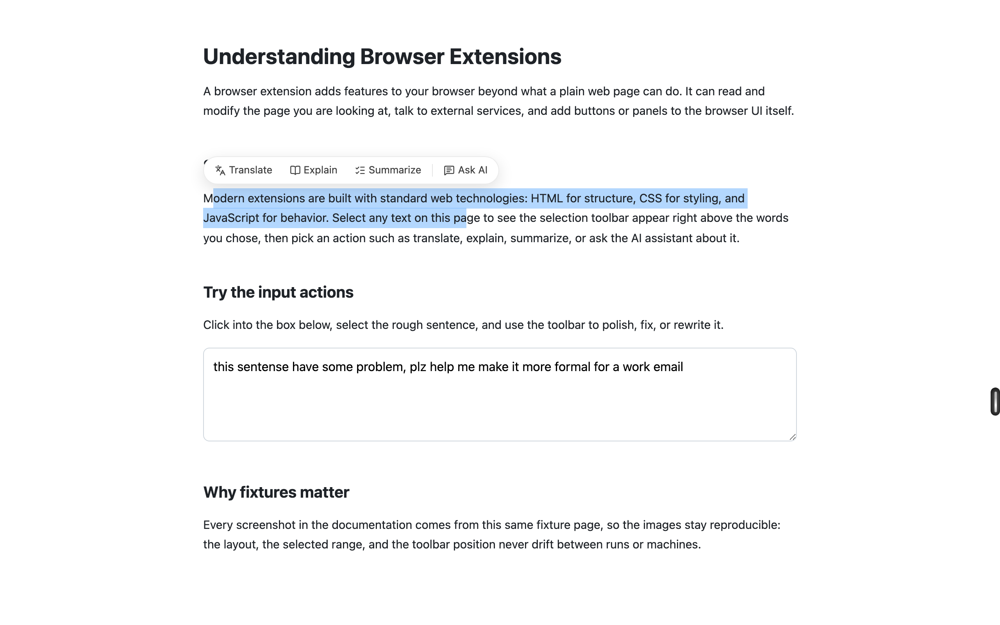
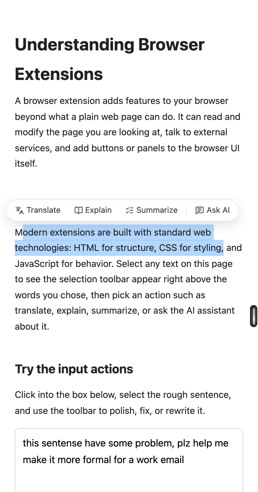

# Floating dock

<!-- Applies to v0.2.3 -->

In one line: a dark strip on the right edge of every page that expands on hover — Translate this page / Show original, AI summary, AI assistant, Back to top, Settings. Drag it up or down; hide it when you don't want it.

## Form

- **Collapsed**: a slim dark strip on the right edge with a subtle breathing glow — barely there
- **Approaching**: the strip eases out slightly to hint it's interactive
- **Hover**: expands along a spring curve into a column of buttons; folds back when the pointer leaves
- Animations turn themselves off when the system enables "Reduce motion"

## Buttons

| Button                              | What it does                                       |
| ----------------------------------- | -------------------------------------------------- |
| Translate this page / Show original | Toggle full-page translation; highlighted while on |
| AI summary                          | Opens the side panel and starts summarizing        |
| AI assistant                        | Opens the side panel chat                          |
| Back to top                         | Appears after you scroll down a bit                |
| Settings                            | Opens settings                                     |

_The floating dock, expanded on hover._

## Dragging

Hold and drag the dock vertically; it remembers where you leave it. Near the bottom of the page it expands upward instead, so buttons never get cut off.

## Hiding and restoring

Click the × at the dock's corner and pick:

| Option            | Scope                 | Where to restore                                        |
| ----------------- | --------------------- | ------------------------------------------------------- |
| Hide for now      | Until this tab closes | New tabs bring it back                                  |
| Hide on {host}    | This site only        | Popup's Features page → "Floating dock"                 |
| Hide on all sites | Everywhere            | Settings → Page enhancements → "Show the floating dock" |

The popup's Features page switch also toggles per site; Settings → Page enhancements adds a master switch and the "Sites where the dock is hidden" list.

## Notes

- Only the topmost page shows it: iframes don't, and it hides automatically in fullscreen video
- Follows the system dark mode for its color scheme

_The floating dock in dark theme._
