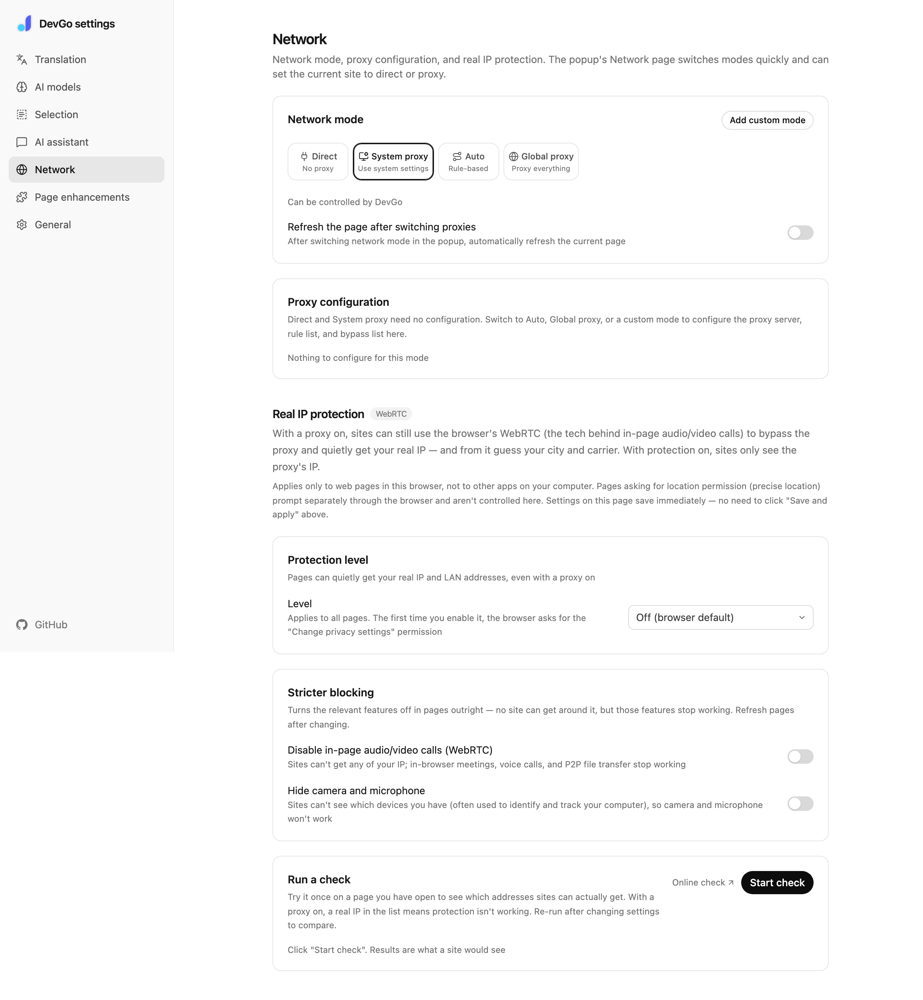

# Real IP protection

<!-- Applies to v0.2.3 -->

In one line: with a proxy on, sites can still use WebRTC to bypass it and grab your real IP — and from it guess your city and carrier. With protection on, sites only see the proxy's IP.

## What it covers — and what it doesn't

- **Covers**: web pages using WebRTC (the tech behind in-page audio/video calls) to slip past your proxy and probe your real IP and LAN addresses
- **Doesn't cover**: other apps on your computer (they don't go through the browser); precise location permission requests — the browser prompts for those separately

If you browse through a proxy, turn protection on. Without a proxy you usually don't need it.

## Protection levels

Under Settings → Network → Real IP protection:

| Level                          | Effect                                               | Cost                                                                        |
| ------------------------------ | ---------------------------------------------------- | --------------------------------------------------------------------------- |
| Off (browser default)          | Pages can quietly get your real IP and LAN addresses | None                                                                        |
| Hide VPN / virtual adapters    | Stops exposing extra adapters like VPNs and VMs      | Minimal: calls that only connect via VPN / virtual adapters may fail        |
| Hide LAN addresses             | Pages can't see home / office network addresses      | Small: same-LAN calls and P2P reroute through the internet, possibly slower |
| **Hide real IP (recommended)** | With a proxy on, pages only see the proxy's IP       | A few in-page video calls may slow down or fail                             |

These settings save immediately — no need to click "Save and apply" above.

## The confirmation dialog: what changes, what's affected

The first time you pick a level (or flip one of the toggles below), DevGo explains three things before anything changes. Only "Confirm" applies it:

**① What DevGo actually does** (for "Hide real IP"): changes the browser's WebRTC settings — disallowing UDP connections that bypass the proxy — so pages' audio/video connections must go through the proxy and sites can't get your real IP. Applies to all pages.

**② Features that may be affected**:

- In-browser video meetings and voice calls (Tencent Meeting / Feishu / Google Meet web, etc.) may slow down, stutter, or fail — more so if the proxy doesn't support UDP
- In-page P2P file transfer, live-stream chat, and real-time connections in some web games
- With no proxy on, some in-page calls may also fail to connect

The dialog also states: **regular browsing, watching videos, downloads, and client apps on your computer (like meeting clients) are unaffected**.

**③ How to recover**: if a web meeting won't connect, set the level back to "Off" to restore. The popup's Network page shows whether protection is on.

The other levels and toggles work the same way: "Disable in-page audio/video calls" lists that all web meetings, voice calls, and screen sharing stop working; "Hide camera and microphone" lists that in-page recording, photo upload, voice input, and identity verification stop working — each dialog ends with its matching recovery step.

<!-- TODO(manual)：开启确认弹窗截图（隐藏真实 IP），路径 shots/0.2.3/manual/ip-confirm.png -->

## Stricter blocking

Beyond levels, two independent toggles no site can get around — at the cost of those features outright. Refresh pages after changing:

- **Disable in-page audio/video calls (WebRTC)**: removes WebRTC interfaces before pages load; sites can't get any of your IPs. All in-browser meetings, calls, and P2P file transfer stop working
- **Hide camera and microphone**: blocks the media-device interfaces; sites can't see which devices you have (often used to identify and track your computer) or use them

## Run a check

Built into the settings page: click "Start check" and a page you have open probes what a site can actually get —

- **Public IP**: with a proxy on, this should be the proxy's IP — your real IP here means protection isn't working
- **LAN address**: your internal address, best kept hidden
- **Local address (anonymized by the browser; safe)**: the browser already mDNS-anonymizes this

Re-run after changing settings to compare.

## Permissions and control status

- The first time you enable protection, the browser asks for the "**Change privacy settings**" permission (`privacy` is optional and only requested when you enable). If it was denied and protection says "Not granted yet", picking the level again re-requests it
- The status line shows what the browser is actually using; "controlled by another extension" (another WebRTC extension, say) or locked by policy means DevGo's settings won't apply until that's resolved

## In the popup

The popup's Network page always shows whether protection is on; with a proxy on but protection off, an orange warning says sites may still see your real IP and links straight to the settings.

_Settings → Network → Real IP protection: protection level, stricter blocking, and the built-in check._
