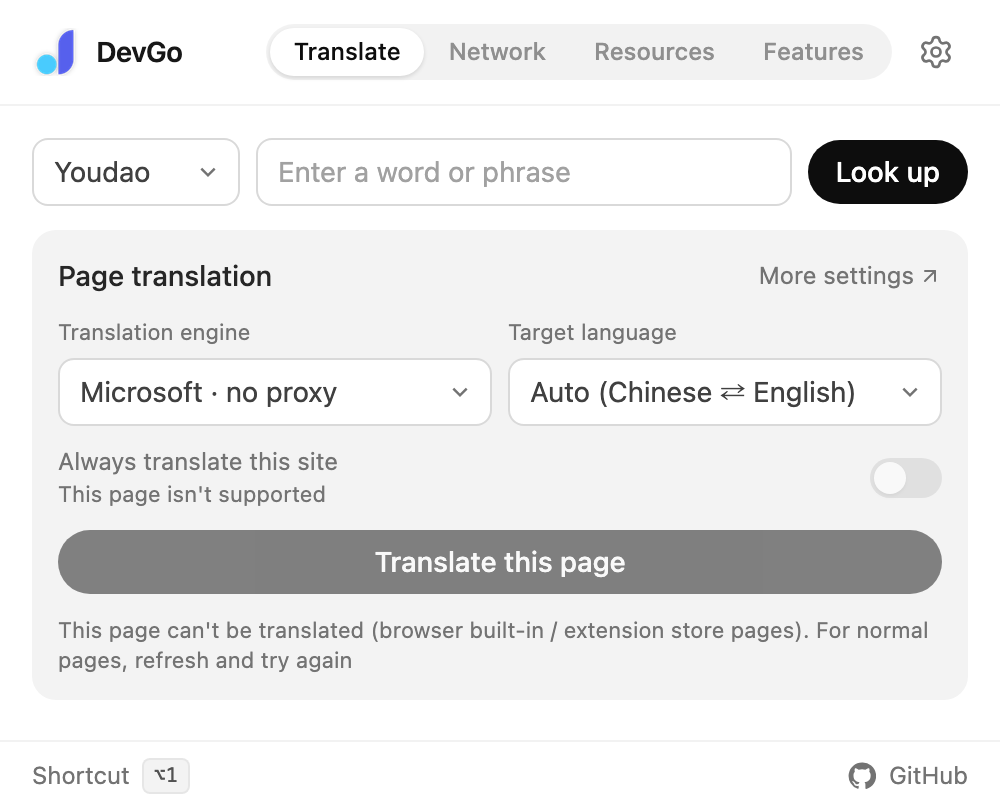

# Popup dictionary

<!-- Applies to v0.2.3 -->

In one line: the popup's Translate page doubles as a dictionary, with Youdao / Microsoft / Google / AI engines; words come with dictionary definitions.

## How to use

Press `Alt+1`, type a word or phrase at the top of the Translate page, and press Enter or click "Look up":

- **Youdao / Microsoft / Google**: free to use; word lookups show dictionary definitions in parallel (phonetics, parts of speech, common senses)
- **AI**: your chat model explains the word and its usage — great for terms and idioms; needs a model configured under [AI models](/en/settings/models)

Below the result: **Copy** and **Read aloud**.

_The popup's Translate page: type a word or phrase and look it up; copy or read aloud below the result._

## Related abilities

The Translate page is also the control panel for page translation:

- **Translation engine / Target language**: switch right under the lookup box; applies to page translation and selection translation at once
- **Always translate this site**: add the current site to the auto-translate list
- **Translate this page / Show original**: toggle full-page translation — see [Full-page bilingual translation](/en/features/page-translate)
- **Hover translation**: enable under Settings → Translation, then press `Alt` while pointing at a paragraph to translate just that one

<!-- TODO(manual)：悬停翻译气泡截图（按 Alt 悬停段落出译文），路径 shots/0.2.3/manual/translate-hover.png -->

## Notes

- With the AI engine and no model configured, the page says "No translation model configured yet" — click "Configure" to fix it
- The Microsoft engine works without a proxy; Google needs one
