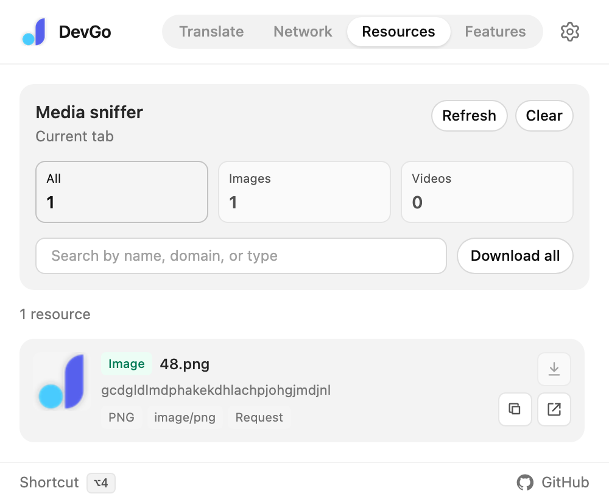

# Media sniffer & bulk download

<!-- Applies to v0.2.3 -->

In one line: sniff the images, videos, and audio on the current tab; filter, search, and download them one by one or in bulk.

## How to use

Open the target page and press `Alt+4` (or open the popup's Resources page):

- Images, videos, and audio loaded by the tab are listed automatically; "Refresh" rescans, "Clear" empties the list
- **Filter**: All / Images / Videos; **search** covers name, domain, and type
- Each entry shows its source (request capture / page DOM) and type; images and common video formats preview inline
- Download / copy link / open link per entry, or "Download all" to create every download at once

_The popup's Resources page: type filters, search, and "Download all"._

## About streaming media

Video sites mostly use HLS / DASH streaming (m3u8 / mpd manifests plus segments). DevGo recognizes and lists these, but **doesn't stitch downloads**:

- Stream manifests and segments saved directly won't produce a complete video; DevGo says so and skips them, so you don't download useless files
- X (Twitter) videos come as separate audio / video tracks, likewise flagged as needing a merge
- For a complete video, copy the link and hand it to a downloader like yt-dlp

## Notes

- Only `http` / `https` resources can be downloaded
- Sniffing covers the **current tab**: switching tabs repopulates the list — download what you need first
