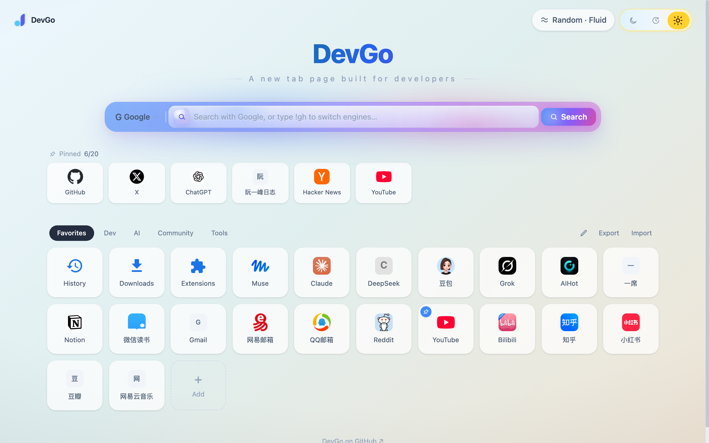

# New tab

<!-- Applies to v0.2.3 -->

In one line: search engines with bang syntax (like `!gh`), search suggestions aggregated from quick links and bookmarks, categorized quick links, and dynamic backgrounds.

## Search: engines and bangs

The box searches with the current engine by default; type `!bang query` to switch engines just for that one search:

| Type                                           | Searches with         |
| ---------------------------------------------- | --------------------- |
| `!gh react`                                    | GitHub                |
| `!npm vite`                                    | npm                   |
| `!mdn fetch`                                   | MDN                   |
| `!so cors error`                               | Stack Overflow        |
| `!g keywords` / `!bd keywords` / `!b keywords` | Google / Baidu / Bing |

As you type, suggestions aggregate your **quick links and browser bookmarks** — frequent sites surface without opening the bookmarks bar.

## Quick links

- Five preset categories — **Favorites / Dev / AI / Community / Tools** — double-click a category name to rename it
- Hover any site card: edit, delete, or **pin it below the search box** (the pinned row has a cap and tells you when it's full)
- Adding a site is name + URL + category

Quick links support **JSON import / export** — move them between machines or keep layouts in sync; duplicates are skipped on import. Default links for fresh installs improve over releases (dead links get removed); anything you've edited yourself is never overwritten.

## Background and theme

- **Dynamic backgrounds**: 12 shader effects — mesh, neuro, simplex, smoke, metaballs, and more — set to "Random" (a new one each time) or "Fixed"
- **Color theme**: Light / Dark / Auto; Auto means dark from 18:00 to 6:00, shared with the popup, settings, and side panel

_The new tab: search with bangs, categorized quick links, dynamic background._

## Notes

- Quick links and proxy configuration [sync across devices](/en/settings/sync) with your browser account; sync storage has a cap (100KB on Chrome) and very large link sets may be asked to slim down
