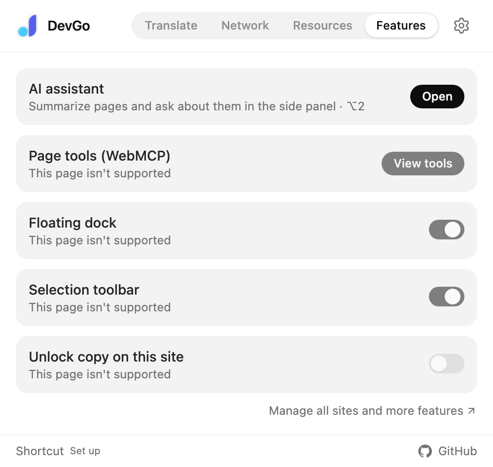
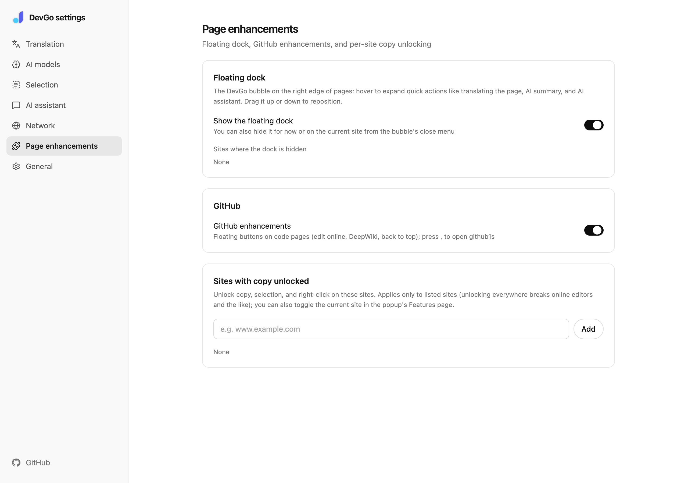

# Page enhancements

<!-- Applies to v0.2.3 -->

In one line: per-site copy unlocking, per-site control of the selection toolbar and floating dock — all togglable for the current site from the popup's Features page.

The Features page is the single entry point for these switches; each affects only the current site and shows its state ("Off on github.com", "3 sites enabled", and so on).

_The popup's Features page: per-site switches showing the current site's state._

## Selection toolbar

Show or hide the selection toolbar on the current site. Online editors and sites with their own selection features are where it gets in the way — turn it off here and every other site keeps it. The list lives under Settings → Selection → "Sites where selection is off". See [Selection toolbar](/en/features/selection-toolbar).

## Floating dock

Show or hide the dock on the current site; Settings → Page enhancements adds the master switch and the "Sites where the dock is hidden" list. See [Floating dock](/en/features/dock).

## Unlock copy on this site

Some sites block copying, text selection, or the right-click menu. Turn this on and those restrictions lift for the current site.

**Why per-site instead of global**: unlocking everywhere breaks online editors and similar sites, so it only applies to sites you add. Toggle the current site from the popup's Features page, or manage the list under Settings → Page enhancements → "Sites with copy unlocked" (one domain per line, e.g. `www.example.com`).

## More

The Features page also holds quick entries for the AI assistant and page tools (WebMCP) — see their own pages; "Manage all sites and more features" at the bottom opens settings.

_Settings → Page enhancements: the dock master switch and the copy-unlocked site list._
