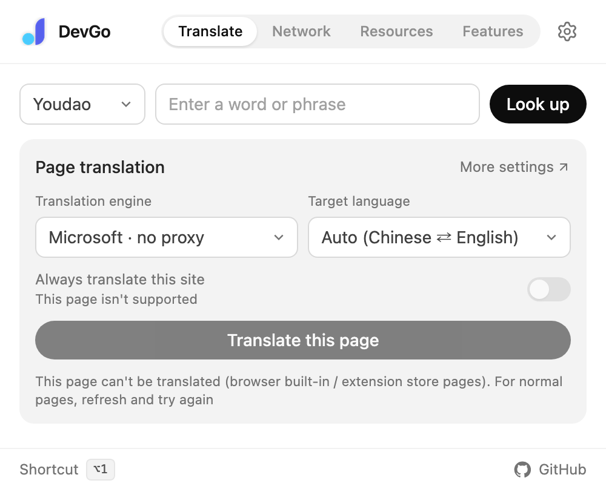
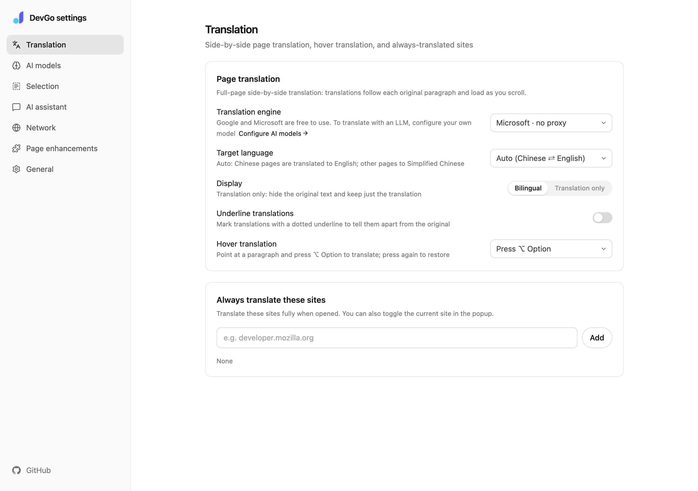

# Full-page bilingual translation

<!-- Applies to v0.2.3 -->

In one line: translations are inserted after each original paragraph, load as you scroll, and one more click restores the original. Shadow DOM / Web Components pages are supported.

## Where to start

- **Popup**: `Alt+1` → Translate page → "Translate this page / Show original"
- **Context menu**: right-click an empty spot → "Translate this page (click again to restore the original)"
- **Floating dock**: hover the right edge → "Translate this page / Show original"
- **Shortcut**: "Toggle page translation" has no default key — bind one at `chrome://extensions/shortcuts`
- **Automatic**: add your go-to sites to "Always translate this site" and they translate on open

_The popup's Translate page: engine, target language, and "Always translate this site"._

## Translation engines

| Engine               | Notes                                                                                                                                   |
| -------------------- | --------------------------------------------------------------------------------------------------------------------------------------- |
| Microsoft · no proxy | Default. Free, reachable without a proxy                                                                                                |
| Google               | Great quality, needs a proxy                                                                                                            |
| AI model             | Translate with your own LLM for control over tone and terminology; configure a translation model under [AI models](/en/settings/models) |

Target language defaults to "Auto (Chinese ⇄ English)": Chinese pages are translated to English, everything else to Simplified Chinese. You can also fix it to any of 17 languages.

## Display

Under Settings → Translation → Page translation:

- **Bilingual** (default): translations follow each original paragraph
- **Translation only**: hide the original for a cleaner read
- **Underline translations**: dotted underline to tell translations apart at a glance

## Hover translation

Don't want the whole page translated? Enable **hover translation** under Settings → Translation and translate one paragraph at a time:

| Mode                           | How it works                                                                                           |
| ------------------------------ | ------------------------------------------------------------------------------------------------------ |
| Press `Alt` / `Ctrl` / `Shift` | Point at a paragraph, press the modifier once to translate, again to restore (default Alt; ⌥ on macOS) |
| Auto after hovering            | Hover over a paragraph briefly to translate it                                                         |

## Always translate this site

Add sites you read often — `developer.mozilla.org`, for example — and they translate automatically on open. You can also toggle the current site from the popup's Translate page.

## Notes

- Browser built-in pages (`chrome://` URLs) and the extension store can't be translated; on normal pages, refresh once if translation doesn't kick in right after install
- Long pages translate on demand: failed paragraphs get a ↻ to retry individually
- With an AI model as the engine, prefer a fast model without deep thinking (glm-5.3-flash, qwen-turbo) — full-page translation stays responsive

_Settings → Translation: display, underline, hover translation, and "always translate" sites._
