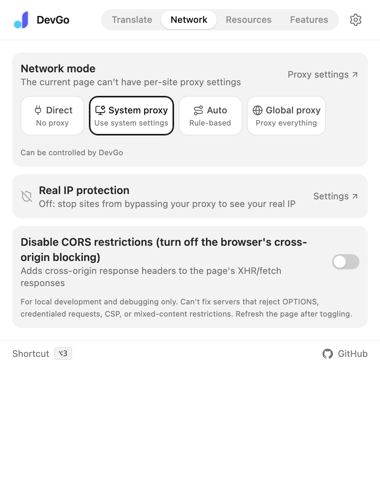
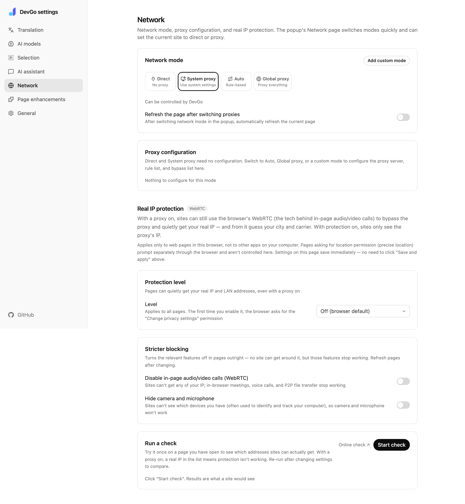

# Proxy & rule-based routing

<!-- Applies to v0.2.3 -->

In one line: Direct / System proxy / Auto / Global proxy in one click, plus custom proxy modes — each mode keeps its own proxy server and bypass list.

## The four network modes

| Mode         | Behavior                                                                     |
| ------------ | ---------------------------------------------------------------------------- |
| Direct       | No proxy                                                                     |
| System proxy | Use system settings                                                          |
| Auto         | Rule-based: matched sites go through the proxy, the rest follow your default |
| Global proxy | Everything goes through the proxy                                            |

Entry points: the popup's Network page (`Alt+3`) to switch quickly; Settings → Network for full configuration.

_The popup's Network page: switch modes in one click; set the current site to direct or proxied at the bottom._

## Per-site shortcuts

At the bottom of the popup's Network page:

- **Direct on this site**: route one site around the proxy (a domestic site that misbehaves through your proxy, say)
- **Proxy this site**: route only the current site through the proxy (same effect as adding it to custom proxy domains in Auto — it takes priority over the rule list)

## How Auto works

Auto = rule list + custom proxy domains + a default for unmatched traffic:

- **Rule list**: AutoProxy / GFWList format. When enabled, matched sites go through the proxy; updated automatically every 6 hours, or manually via "Update / Download"
- **Custom proxy domains**: sites that need the proxy but aren't in the rules — one domain per line, subdomains included
- **When no rule matches**: defaults to "Direct" (only matched sites use the proxy). If your proxy app handles its own routing, switch to "Proxy" — everything goes through except the bypass list, LAN, and `.cn` domains

With no rules and no custom domains, Auto is equivalent to Direct.

<!-- TODO(manual)：设置页「网络模式」分区裁切图，路径 shots/0.2.3/zh-CN/light/options-network-mode.png -->

<!-- TODO(manual)：设置页「自动模式规则」分区裁切图，路径 shots/0.2.3/zh-CN/light/options-network-rules.png -->

## Custom proxy modes

Beyond the built-ins, "Add custom mode" lets you name different proxy servers ("Work", "Home") and switch between them in one click. Each mode keeps its own proxy server (scheme / host / port) and bypass list.

## Notes

- **Proxy server and bypass list** changes need "Save and apply"; the rule list, proxy domains, and real IP protection take effect immediately
- The proxy config bar sticks to the bottom, highlights unsaved changes, and confirms before you leave
- Turn on "Refresh the page after switching proxies" so the current page reloads after a mode switch — no half-old connections
- Once DevGo controls the proxy, the browser's extension card shows "Controlled by DevGo"; if it says another extension controls it, disable that extension first
- **Firefox isn't supported yet** (a Chromium-specific API limitation) — see the [FAQ](/en/faq/#proxy-switching-doesn-t-work-in-firefox)

_Settings → Network: proxy configuration, the rule list, and real IP protection, all on one page._
