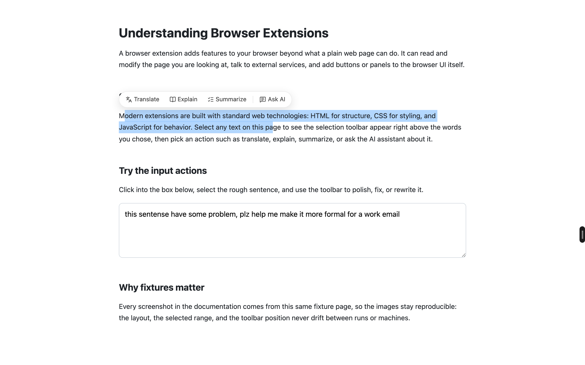
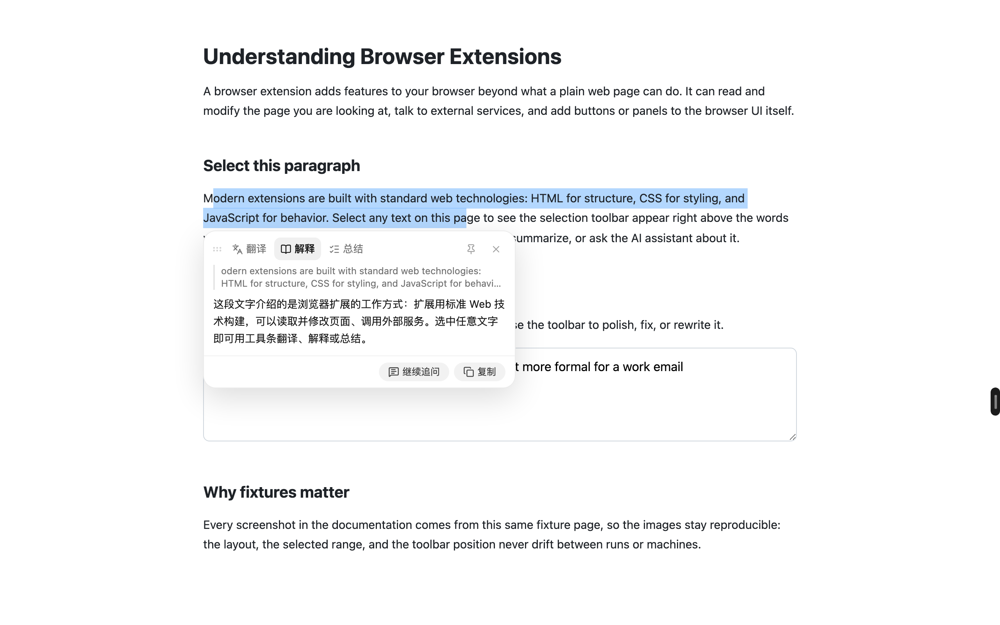
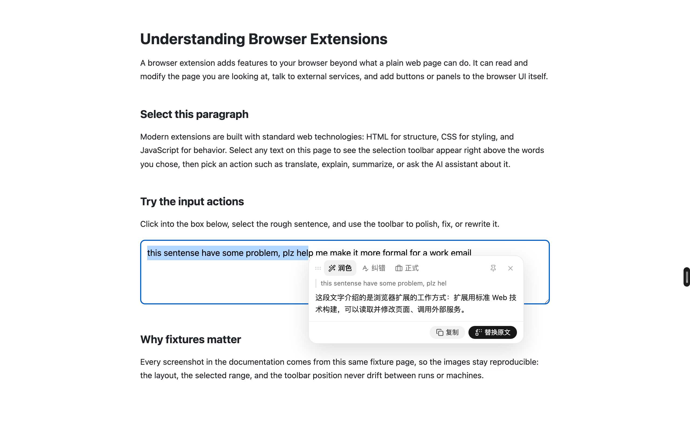
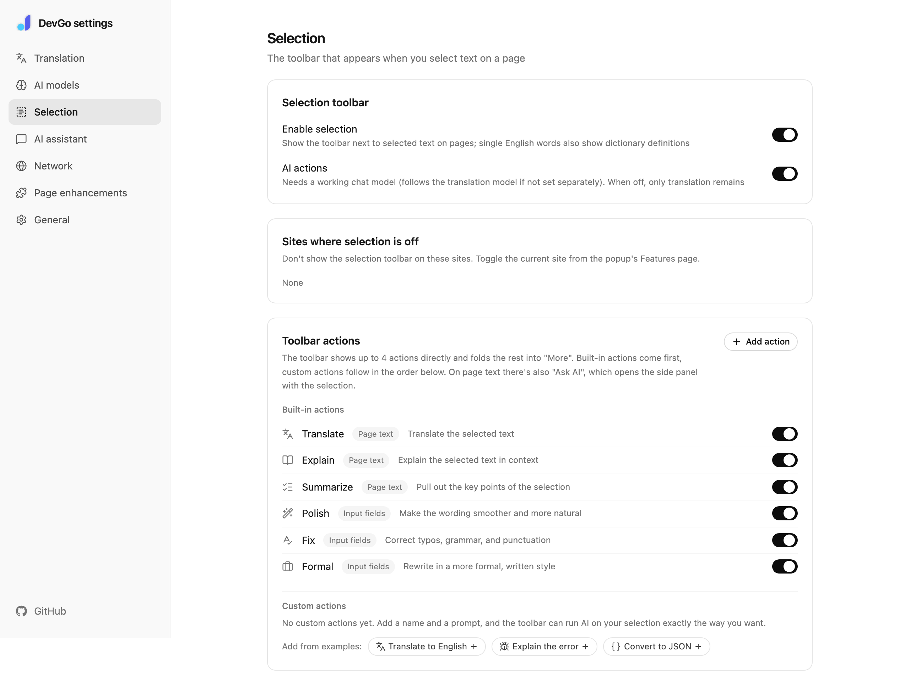

# Selection toolbar & custom actions

<!-- Applies to v0.2.3 -->

In one line: select text on a page and a toolbar appears above it — translate, explain, summarize, or ask AI. Select text in an input field and the toolbar switches to writing mode: polish, fix, or formalize, then replace the original in one click.

## On page text

Select text and the toolbar pops up:

- **Translate**: translates the selection; a single English word also shows dictionary definitions
- **Explain / Summarize**: the AI reads the surrounding paragraph and page title for context
- **Ask AI**: opens the side panel with the selection attached
- More than four actions fold into the "More" menu

_The selection toolbar on page text._

The result panel sits right below the selection and follows it as the page scrolls; pin it to freeze it on screen, or drag it anywhere. The bottom row supports **Copy**, **Follow up**, and **Retry**.

_The "Explain" result panel: switch actions at the top; follow up or copy at the bottom._

## In input fields

Select text inside an input (comment boxes, search boxes, web editors) and the toolbar switches to writing mode: **Polish, Fix, Formal**, plus your custom actions that apply to inputs. When the AI finishes, click "Replace original" to swap the field's content for the result.

_Writing mode in an input field — after the AI polishes the text, "Replace original" swaps it in. (Screenshot shows the Chinese UI; an English version is pending.)_

## Custom actions

When the built-ins aren't enough, add your own under Settings → Selection → Toolbar actions → Add action:

- **Name**: shown on the toolbar, e.g. "Translate to English"
- **Icon**: pick from 12 common icons
- **Applies to**: Page text / Input fields / Both
- **Prompt**: tell the AI how to handle the selection, e.g. "organize the selection into clean JSON and output only the JSON"

No need to wire up context yourself — like built-in actions, requests automatically attach the paragraph around the selection and the page title.

Three example templates ship built-in, one click to add: **Translate to English**, **Explain the error**, **Convert to JSON**.

The management area also supports edit, delete (with confirmation), and move up / move down; built-in actions can be hidden individually. The toolbar shows up to four actions directly — the rest go into "More".

_Settings → Selection → Toolbar actions: built-in action switches and custom action management._

## Toggles

- **Global switch**: Settings → Selection → "Enable selection"; "AI actions" can be turned off separately (translation only)
- **Per site**: the popup's Features page has a switch for the current site only — turning it off shows "Off on {host}". The list is managed under Settings → Selection → "Sites where selection is off"

## Notes

- AI actions need a [chat model](/en/settings/models) (the translation model is used until one is set separately)
- For one annoying site — an online editor, say — use per-site off rather than killing the global switch
- Custom actions are included in [backup export / import](/en/settings/sync), so they survive a machine switch
