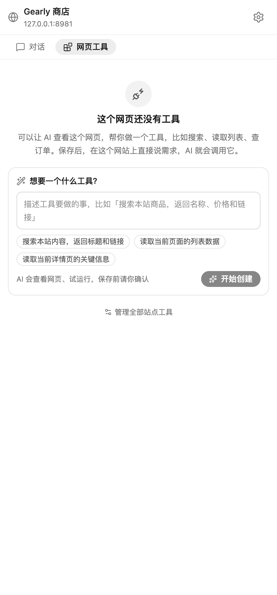
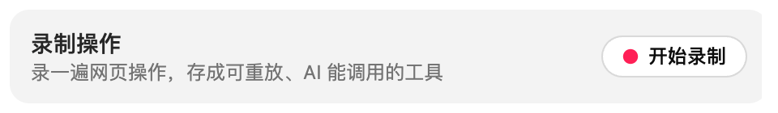
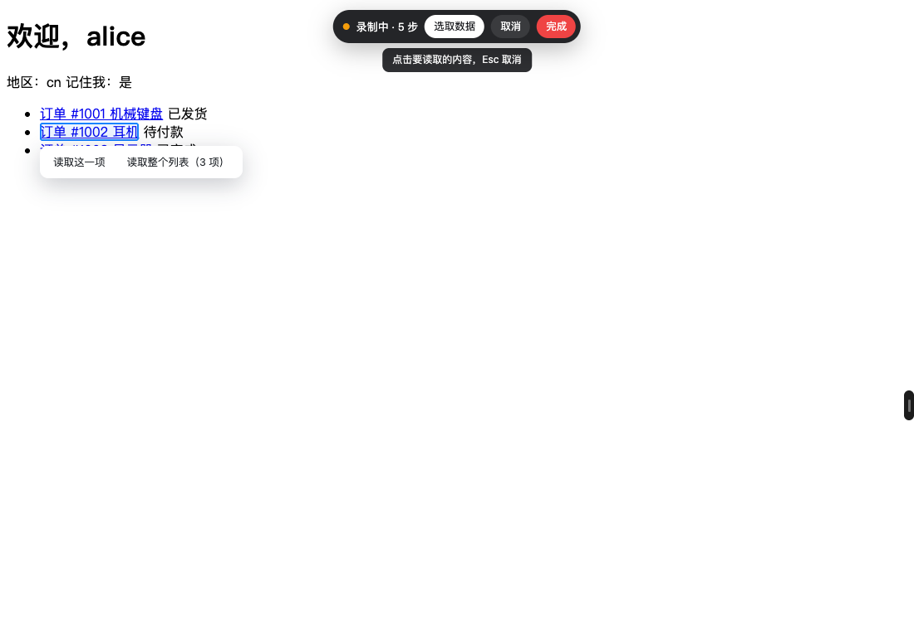
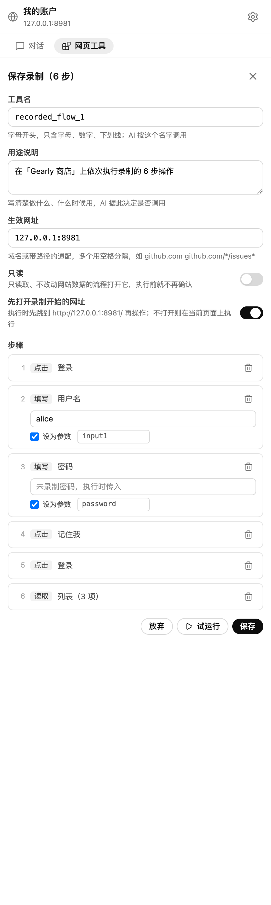
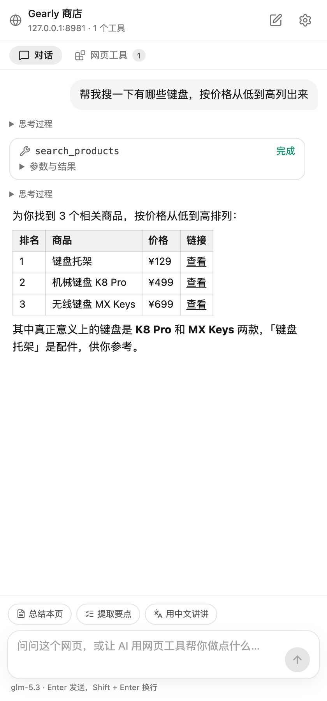
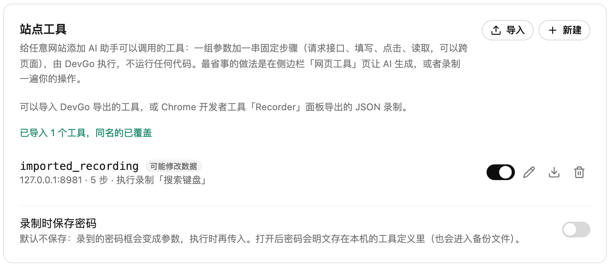

# Site tools & recording

<!-- Applies to v0.2.5 -->

In one line: add tools the AI assistant can call to any website — "search products on this site", "read my order list", "fill in this form and submit". Let the AI build one by looking at the page, or record your own actions once; saved tools can be replayed with one click or called automatically by the AI in chat.

How this differs from [Page tools (WebMCP)](/en/features/webmcp): WebMCP tools are provided by the site itself, and most sites don't have any yet. Site tools are ones you add yourself — they work on any site and don't need the browser's experimental flag.

## Option 1: let the AI build it

1. Open the site, open the side panel (`Alt+2`) and switch to "**Page tools**"
2. If the site has no tools yet, the page shows a "What tool do you need?" box right away; otherwise click "**New tool with AI**"
3. Describe what you need, or click one of the examples ("Search this site and return titles and links", "Read the list data on this page", …), then click "**Create**"
4. Follow along in chat: the AI **inspects the page** → writes the tool → **test-runs** it, fixing mistakes on its own
5. Before saving, a confirmation card shows the full tool definition; nothing is saved until you click "Allow"

_The Page tools page: with no tools yet, describe what you need and let the AI build it (Chinese UI)._

You can also just say "make a search tool for this site" in Chat — same result.

## Option 2: record your actions

Best for step-by-step flows ("click here, pick that, fill this in, submit"). You do it once by hand, so the steps are exact — no AI involved, and it works even without a model configured.

**Start recording**: click "Record" on the "Record actions" row of the popup's Features tab, or "**Record actions**" on the side panel's Page tools page.

_The "Record actions" entry on the popup's Features tab (Chinese UI)._

**While recording**: a recording bar appears at the top of the page. Just use the page:

- Clicks, typing, checkboxes, dropdowns and Enter are recorded; repeated typing in one field keeps only the final value
- Recording continues across page navigations (e.g. home → login → account)
- To make the tool return data, click "**Pick data**" on the bar, click the content to read, and choose "Read this item" or "Read the whole list (N items)" — similar list items are detected automatically
- Click "**Done**" to finish (or "Finish" in the popup); "Cancel" discards the recording

_The recording bar and "Pick data": clicking an order offers to read that item or the whole list (Chinese UI)._

**Review and save**: when you finish, the side panel opens a review page:

- Tick "**Make it a parameter**" next to any entered value so it can change next time (a search keyword, a username)
- Edit the tool name, the description (the AI uses it to decide when to call the tool) and the sites it applies to
- "**Read-only**": turn on for flows that only read and don't change data; they then run without confirmation (off by default)
- "**Open the starting URL first**": every run first goes to where recording started (off by default — runs on the current page)
- Remove any unwanted steps; "**Test run**" to check (a test run always returns to the starting URL first), then "**Save**"

_The review page: the username is made a parameter; the password wasn't recorded and is passed in at run time (Chinese UI)._

### Passwords

Passwords are **not recorded** by default: a recorded password field becomes a parameter that's passed in when the tool runs. If you really want them saved for convenience, turn on "**Save passwords when recording**" under Settings → AI assistant → Site tools. Passwords are then stored in plain text in the local tool definition and included in backup files — weigh that before enabling it.

## Using tools

- **Let the AI call them**: on that site, just ask — "find keyboards and list them by price" — and the AI calls the matching site tool
- **Run manually**: on the side panel's Page tools page, site tools carry a "Site tool" badge; expand a card, fill in arguments and click "Run"

_The AI calling a site tool in chat and presenting the result as a table (Chinese UI)._

Tools that may change data (not marked read-only) ask for confirmation before running — the same switch as for page tools (Settings → AI assistant).

## Managing, importing and exporting

Settings → **AI assistant → Site tools** lists every site tool. You can:

- Enable / disable, edit (as JSON), or delete them
- **Export** a tool as a JSON file to share it
- **Import** tools exported from DevGo, or JSON recordings exported from the **Chrome DevTools Recorder** panel — existing recordings become site tools directly

Site tools are included in [backups](/en/settings/sync).

_The Site tools card in Settings: import / export, enable switches and "Save passwords when recording" (Chinese UI)._

## How it works & limits

- A tool is **pure data**: a few parameters plus fixed steps (call an API, fill, press a key, click, wait, read, open a URL), run by DevGo's built-in executor. **No code is executed**, no extra permissions are needed, and it works on sites with strict security policies such as GitHub
- Each element is saved with 3–5 candidate selectors (by name, attributes, text, path), so small site changes fall back automatically; actions wait for their element to appear first
- Multi-page flows work: when a click or URL causes navigation, the remaining steps continue once the new page has loaded
- Tools work right after DevGo is installed or updated, without refreshing open pages
- Not supported yet: elements inside iframes, drag / hover / scroll. After a big site redesign selectors may break — ask the AI to "fix this tool", or record it again
- Sites are matched by domain (`github.com`, including subdomains) or a wildcard path (`github.com/*/issues*`); tools only appear on matching sites
