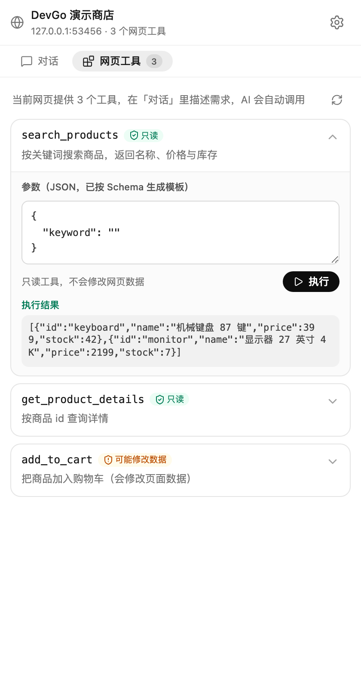

# Page tools (WebMCP)

<!-- Applies to v0.2.5 -->

In one line: DevGo lists the tools a page registers through WebMCP (iframes included) and the AI can call them to get things done. The side panel's "Page tools" page shows each tool's description and lets you run it manually — handy for debugging your own WebMCP implementation.

> Site doesn't provide any tools? Add your own: see [Site tools & recording](/en/features/site-tools). Site tools appear on the same Page tools page and don't need the experimental flag below.

## Requirements

WebMCP is currently a Chrome experiment:

1. Use **Chrome 150 or later**
2. Open `chrome://flags`, search for "**WebMCP for testing**", and enable it
3. Restart the browser

Without it, the page's own WebMCP tools don't show up and a note appears at the bottom of the Page tools page; [site tools](/en/features/site-tools) still work. Firefox doesn't support the side panel for now.

## Using it

Open a page that provides tools and switch the side panel to the "Page tools" page (or click "View tools" on the "Page tools" row of the popup's Features tab; when the page has no tools yet the button reads "Create"):

- Each tool is a card: name, a **Read-only** or **May modify data** badge (iframe tools and your own site tools are marked), and a description
- Expand a card to fill in arguments from the schema-generated template, click "Run", and the result or error appears below
- The header shows the tool count, with "Check again" on the right (single-page apps can register / unregister tools at any time)
- With no tools at all, the page shows a "What tool do you need?" box so the AI can build one for this site, plus "Record actions" — see [Site tools & recording](/en/features/site-tools)

The easier path: describe what you want in Chat — "search for a red T-shirt" — and the AI calls the tools itself.

_The "Page tools" page: tool cards with Read-only / May modify data badges; search_products has been run and returned results._

## Confirm before running

Tools provided by pages and **not declared read-only** (they may submit forms, place orders, etc.) show a confirmation card before running — "Allow" or "Reject". This protection is on by default and can be turned off under Settings → AI assistant (not recommended).

## For web developers

Register tools via `document.modelContext` and DevGo discovers them automatically; argument schemas are used to generate the fill-in template. Running tools manually on the "Page tools" page is the quickest way to debug your WebMCP implementation — no glue code required.
