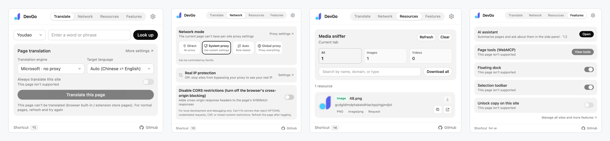
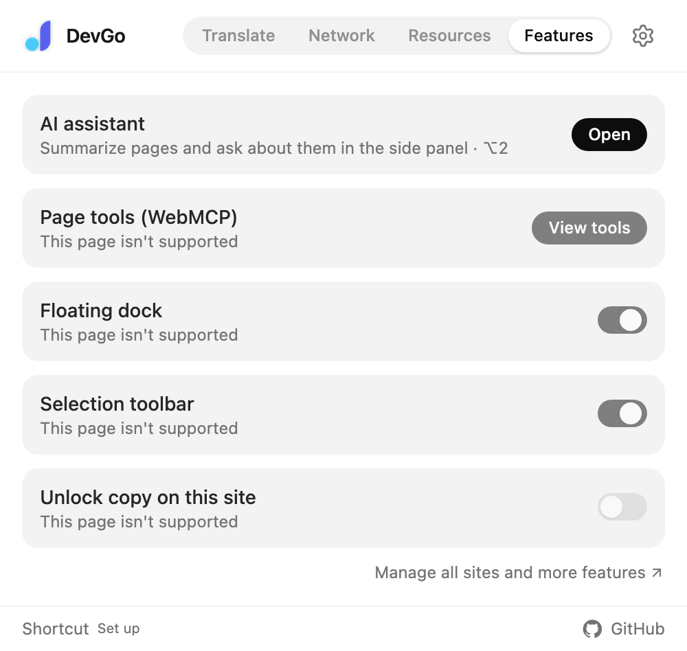

# What is DevGo

<!-- Applies to v0.2.3 -->

DevGo is a browser extension built for developers: translation, an AI assistant, proxy management with real IP protection, and media sniffing — all in one extension that speaks both Chinese and English, on Chrome and Firefox.

Instead of installing five extensions that each do one thing, DevGo aims to make every feature stand on its own while sharing the same config and interaction language.

## What it can do

| Capability                      | In one sentence                                                               | Docs                                                           |
| ------------------------------- | ----------------------------------------------------------------------------- | -------------------------------------------------------------- |
| Full-page bilingual translation | Translations follow the original paragraphs; Shadow DOM pages supported       | [Full-page bilingual translation](/en/features/page-translate) |
| Selection toolbar               | Translate, explain, or summarize any text you select — with custom AI actions | [Selection toolbar](/en/features/selection-toolbar)            |
| AI assistant                    | Summarize the page and ask questions about it, in a side panel                | [AI assistant](/en/features/assistant)                         |
| Page tools (WebMCP)             | The AI can call tools registered by the page and act on it for you            | [Page tools (WebMCP)](/en/features/webmcp)                     |
| Proxy & rule-based routing      | Four network modes, one click to switch; rules route traffic automatically    | [Proxy & rule-based routing](/en/features/proxy)               |
| Real IP protection              | Stop sites from using WebRTC to grab your real IP while you're on a proxy     | [Real IP protection](/en/features/ip-protection)               |
| Media sniffer                   | Sniff images, videos, and audio on the current tab; download in bulk          | [Media sniffer](/en/features/media-sniffer)                    |
| Floating dock                   | Quick actions on the right edge of every page                                 | [Floating dock](/en/features/dock)                             |
| New tab                         | Search engines with bang syntax, quick links, dynamic backgrounds             | [New tab](/en/features/newtab)                                 |
| Page enhancements               | Per-site copy unlocking and GitHub enhancements                               | [Page enhancements](/en/features/page-enhance)                 |

## The interface in 30 seconds

DevGo's day-to-day controls live in three places:

- **The popup**: click the toolbar icon (or press `Alt+1`). Four pages — Translate, Network, Resources, Features — hold only the high-frequency actions for the current page.
- **The side panel**: press `Alt+2` for the AI assistant — summarize pages, ask about their content.
- **Settings**: everything is configured here, organized into Translation / AI models / Selection / AI assistant / Network / Page enhancements / General.

_The popup's four pages — Translate, Network, Resources, Features — in one view._

_The popup's Features page: per-site switches for the selection toolbar, floating dock, and copy unlocking._

After [installing](/en/guide/install), walk through the [Quick start (5 minutes)](/en/guide/quick-start).

## Links

- [Chrome Web Store](https://chrome.google.com/webstore/detail/devgo/kcofdbjhicjdbmldlcffcijglkifnnjn)
- [GitHub repository](https://github.com/fedtop/DevGo)
- [Offline builds on GitHub Releases](https://github.com/fedtop/DevGo/releases)
