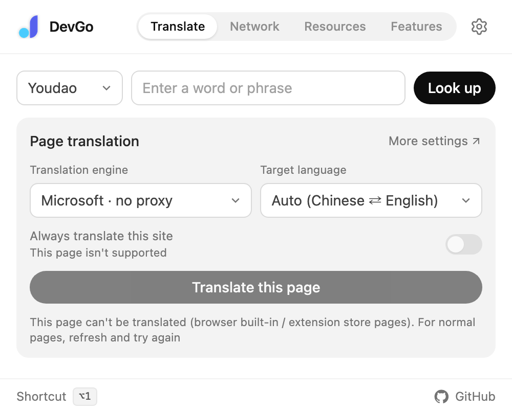
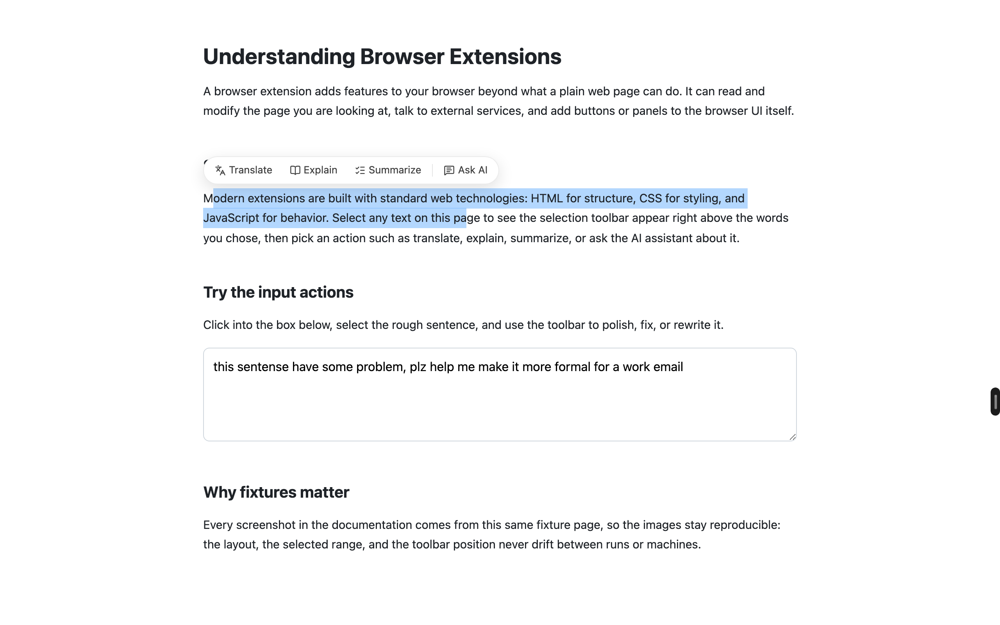

# Quick start (5 minutes)

<!-- Applies to v0.2.3 -->

Three things to try after installing DevGo — they cover the core of what it does.

## 1. Full-page bilingual translation

**What it does**: translates the whole page, with each translation placed right after the original paragraph.

**How**: open any page in a foreign language, then pick one —

- Toolbar icon → Translate page → "Translate this page"
- Right-click an empty spot → "Translate this page (click again to restore the original)"
- Bind a shortcut for "Toggle page translation" at `chrome://extensions/shortcuts`

Translations load as you scroll — long pages don't wait for the whole thing. Click "Show original" to restore.

_The popup's Translate page: "Translate this page" starts the bilingual view; translations load as you scroll._

::: tip
The default engine is Microsoft (works without a proxy). You can switch to Google or your own AI model — see [Full-page bilingual translation](/en/features/page-translate).
:::

## 2. Selection translation and AI actions

**What it does**: select text and a toolbar appears — no page navigation needed.

**How**: select text on a page —

- On page text: **Translate / Explain / Summarize / Ask AI**; selecting a single English word also shows dictionary definitions
- In input fields: **Polish / Fix / Formal**, plus custom actions that apply to inputs; AI results can replace the original text in one click
- Need more actions? Add your own under Settings → Selection → Toolbar actions (e.g. "Convert to JSON", "Explain the error") — just a name and a prompt

_The toolbar that appears when you select text: Translate / Explain / Summarize / Ask AI._

::: tip
AI actions need a model first — see [AI models](/en/settings/models). Find the toolbar distracting? Turn it off for just the current site from the popup's Features page.
:::

## 3. Floating dock

**What it does**: a slim dark strip on the right edge of every page; hover to expand quick actions.

**How**: move the pointer to the right edge —

- **Translate this page / Show original**: toggle full-page translation
- **AI summary**: opens the side panel and starts summarizing
- **AI assistant**: opens the side panel chat
- **Back to top**: appears after you scroll down a bit

The dock can be dragged up and down. Click the × at its corner to hide it — for now, on this site, or on all sites.

_The floating dock on the right edge, expanded on hover._

## Default shortcuts

| Shortcut                | Action                                                                |
| ----------------------- | --------------------------------------------------------------------- |
| `Alt+1` (`⌥1` on macOS) | Open the popup (default page)                                         |
| `Alt+2` (`⌥2` on macOS) | Open / close the side panel AI assistant                              |
| `Alt+3` (`⌥3` on macOS) | Open the popup's Network page                                         |
| `Alt+4` (`⌥4` on macOS) | Open the popup's Resources page                                       |
| Not bound               | Toggle page translation (bindable at `chrome://extensions/shortcuts`) |

All shortcuts are customizable — see [General & appearance](/en/settings/general#shortcuts).

## Next steps

- Configure [AI models](/en/settings/models) to unlock AI explain, summarize, polish, and the side panel assistant
- Browsing through a proxy? Read up on [Real IP protection](/en/features/ip-protection)
- Want the AI to act on pages? See [Page tools (WebMCP)](/en/features/webmcp)
