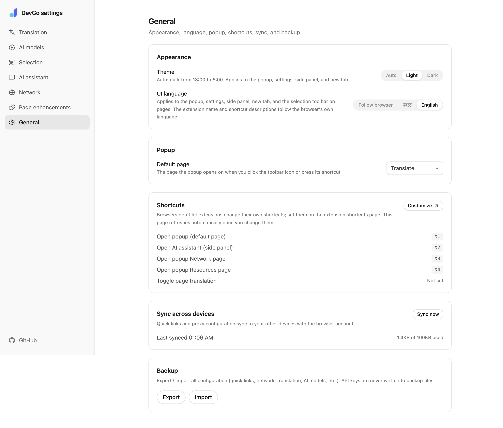
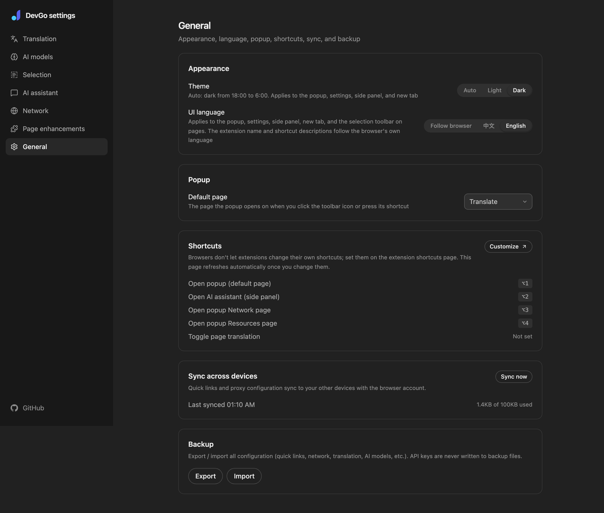

# General & appearance

<!-- Applies to v0.2.3 -->

In one line: theme, UI language, the popup's default page, shortcuts, sync, and backup — all under Settings → General.

## Appearance

- **Theme**: Light / Dark / Auto. Auto goes dark from 18:00 to 6:00; applies to the popup, settings, side panel, and new tab together
- **UI language**: Follow browser / Chinese / English. Switching takes effect immediately — open pages included, no refresh needed. The extension's name and shortcut descriptions follow the browser's own language (they come from the manifest, which manual switching can't override)

_Settings → General: appearance, language, shortcuts, sync, and backup._

_General settings in dark theme._

## Popup

**Default page**: which page the popup opens on when you click the toolbar icon or press `Alt+1` (Translate / Network / Resources / Features). Network and Resources also have dedicated shortcuts, `Alt+3` and `Alt+4`.

## Shortcuts

| Command                        | Default key           |
| ------------------------------ | --------------------- |
| Open popup (default page)      | `Alt+1`               |
| Open AI assistant (side panel) | `Alt+2` (Chrome only) |
| Open popup Network page        | `Alt+3`               |
| Open popup Resources page      | `Alt+4`               |
| Toggle page translation        | Not bound; bindable   |

Browsers don't let extensions change their own shortcuts:

- **Chrome / Edge**: change them at `chrome://extensions/shortcuts`; this page refreshes the display once you're back
- **Firefox**: `about:addons` → gear icon at the top right → "Manage Extension Shortcuts"

## Sync across devices

Quick links and proxy configuration sync to your other devices with your browser account (Chrome caps sync storage at 100KB; usage is shown here). "Sync now" triggers a manual run and shows the last sync time.

## Backup

**Export** writes a JSON file with all settings (quick links, network, translation, AI models, selection actions, and the rest); **Import** restores it. API keys are **never** written to backup files and need re-entering after a move. See [Backup & sync](/en/settings/sync).
