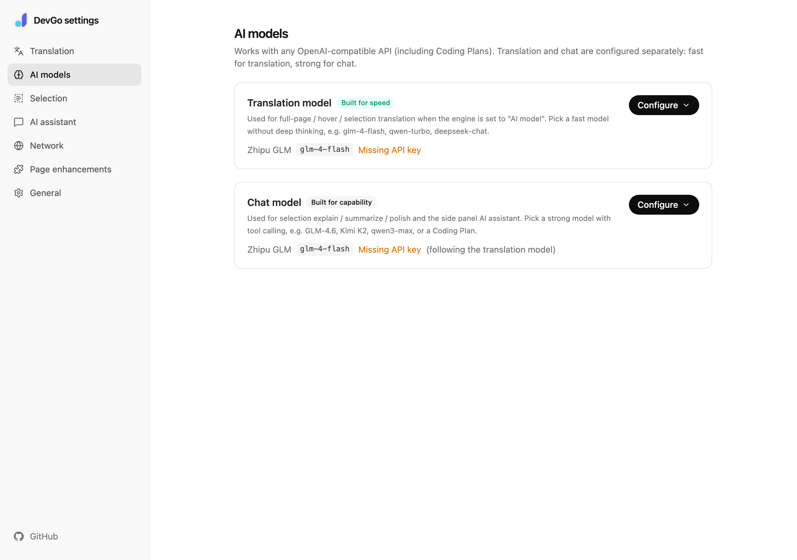

# AI models

<!-- Applies to v0.2.3 -->

In one line: translate with Google, Microsoft (no proxy needed), or any OpenAI-compatible LLM — and configure the translation and chat models separately: fast for translation, strong for chat.

## Two models, two jobs

| Config                | Where it's used                                                           | How to choose                                                                                          |
| --------------------- | ------------------------------------------------------------------------- | ------------------------------------------------------------------------------------------------------ |
| **Translation model** | Full-page / hover / selection translation (when the engine is "AI model") | Built for speed: a fast model without deep thinking — glm-4-flash, qwen-turbo, deepseek-chat           |
| **Chat model**        | Selection explain / summarize / polish, and the side panel assistant      | Built for capability: a strong model with tool calling — GLM-4.6, Kimi K2, qwen3-max, or a Coding Plan |

The chat model follows the translation model until you save a separate config; "Follow the translation model again" switches back if you'd rather maintain one.

_Settings → AI models: translation and chat models, configured separately._

## What you fill in

Three things:

1. **Provider preset**: Zhipu GLM, the Z.ai / Bailian / Ark Coding Plans, Qwen, Doubao, Ollama (local), or Custom. Picking one fills in the base URL
2. **Base URL**: up to `/v1` is enough — `/chat/completions` is appended automatically
3. **API key**: stored locally only, **never in backups**; leave it empty for local Ollama (set `OLLAMA_ORIGINS=chrome-extension://*` so the extension may connect)

**Model** can be picked from the list once the URL and key are in (the list can be fetched automatically); "Test connection" verifies the whole setup in one click.

## Custom instructions (optional)

Append to the system prompt, separately for translation and the assistant:

- Translation: use it as a glossary, e.g. "technical-doc style; never translate Token"
- Assistant: set the tone, e.g. "keep answers short" or "list the steps before acting"

## Notes

- Coding Plan keys only work with their dedicated base URLs; some plans restrict usage to coding tools — check your plan's terms
- On Volcano Ark, the model name is the console's model ID or inference endpoint ID (`ep-xxxx`)
- The paragraph around the selection and the page title are attached automatically — don't add them to custom instructions yourself
