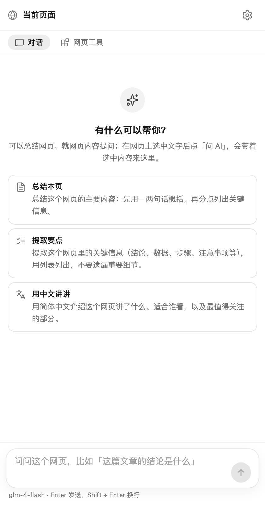
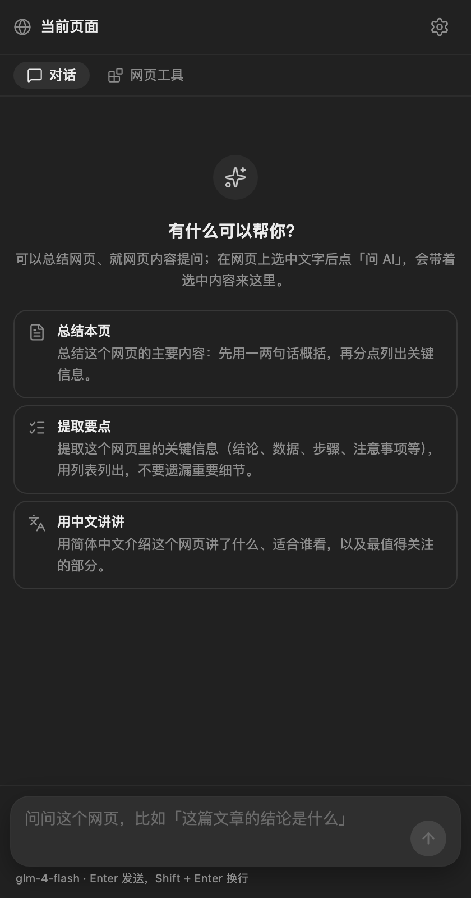

# AI 助手

<!-- 适用版本：v0.2.3 -->

一句话：侧边栏 AI 助手（`Alt+2` 打开 / 关闭），一键总结本页、提取要点，就网页内容提问，AI 会自行读取网页正文；划词「问 AI」也会带着选中内容过来。

## 打开方式

- 快捷键 `Alt+2`（macOS 为 `⌥2`），再按一次关闭
- 弹窗「功能」页 → AI 助手 →「打开」
- 悬浮快捷栏 →「AI 助手」或「AI 总结本页」

::: warning
`Alt+2` 是 Chrome 专有快捷键；Firefox 的侧边栏由浏览器自身控制，从弹窗或悬浮快捷栏打开即可。
:::

## 快捷指令

侧边栏顶部内置三个快捷指令，点一下就带着当前网页开问：

| 指令       | 做什么                                   |
| ---------- | ---------------------------------------- |
| 总结本页   | 先一两句话概括，再分点列出关键信息       |
| 提取要点   | 列出结论、数据、步骤、注意事项等关键信息 |
| 用中文讲讲 | 用简体中文介绍这个网页讲了什么、适合谁看 |

## 对话

- AI 会自动读取当前网页正文（包括 Shadow DOM 渲染的页面），不用手动复制粘贴
- 回答流式输出，支持展开查看**思考过程**
- 划词「问 AI」会把选中内容作为引用带进来，也可以输入框上方手动「移除引用」
- 网页提供了 WebMCP 工具、或你给这个网站加了[站点工具](/features/site-tools)时，AI 可以直接调用工具在网页上操作（见[网页工具](/features/webmcp)），执行过程以卡片形式显示在对话里
- 说「给这个网站做一个搜索工具」，AI 会查看网页、试运行后帮你生成站点工具
- 回答支持 Markdown：标题、列表、代码块、表格等

输入框：`Enter` 发送，`Shift + Enter` 换行；生成过程中可以点「停止」。

_图：侧边栏 AI 助手——顶部快捷指令，输入框直接就当前网页提问。_

_图：深色主题下的侧边栏。_

## 模型配置

助手使用[对话模型](/settings/models)（与翻译模型分开配置）：建议选能力强、支持工具调用的模型。侧边栏右上角「设置」可以直达配置，也可以追加自定义要求（如「回答尽量简短」）。

## 注意事项

- 未配置模型时输入框会提示「先在设置里配置对话模型」
- 浏览器内置页面（`chrome://` 开头）无法读取正文；安装或更新扩展前就打开的页面，DevGo 会自动补注入，不用刷新
