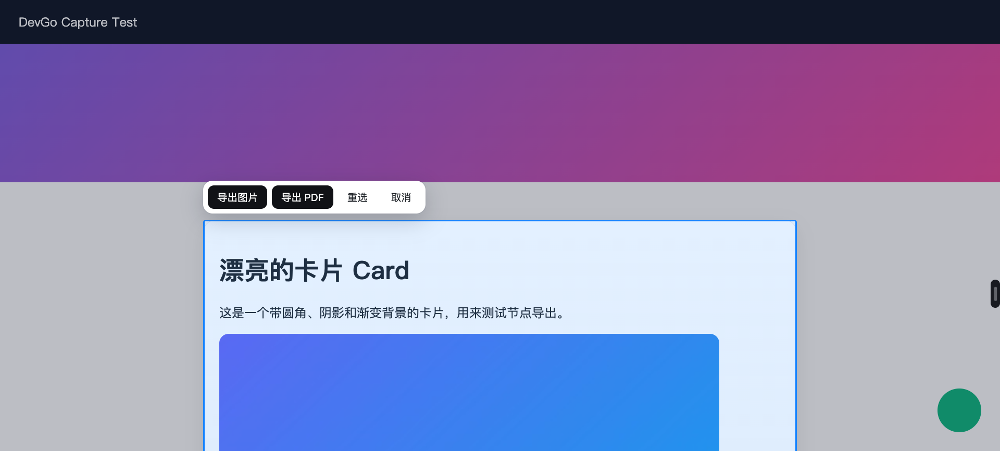

# 网页导出（PDF / 长图）

<!-- 适用版本：v0.2.5 -->

一句话：把当前网页导出成和屏幕上一模一样的 PDF 或长图，样式、图片都不丢；也可以只框选页面上的某一块单独导出。

## 怎么用

打开要导出的网页，点工具栏图标打开弹窗，切到「功能」页，找到「导出网页」：

| 按钮         | 效果                                                                                 |
| ------------ | ------------------------------------------------------------------------------------ |
| **整页 PDF** | 从头到尾滚动截取整个页面，拼成 PDF。PDF 里的文字可以选中、复制和搜索                 |
| **整页长图** | 同样截取整页，保存为一张 PNG 长图                                                    |
| **选择区域** | 弹窗关闭，在网页上用鼠标选中一块（卡片、表格、某段内容），导出成图片或 PDF，见下一节 |

导出的文件直接保存到浏览器的下载目录，弹窗里会显示文件名。网页右键菜单里也有「将网页导出为 PDF」和「选择网页区域导出为图片 / PDF」。

## 选择区域导出

点「选择区域」后：

1. 鼠标移到页面上，蓝框会高亮当前元素，并标出它的尺寸
2. 选得太小或太大时，按 **↑** 选父元素、**↓** 回到子元素
3. 点击锁定，弹出操作条：**导出图片** / **导出 PDF** / **重选** / **取消**；**Esc** 随时退出

导出的是这个元素的**完整内容**，不只是屏幕上能看到的那一部分：元素比一屏还高时会自动滚动分段截取再拼起来。

_图：选择区域导出——选中卡片后弹出操作条。_

## 和「打印成 PDF」有什么不一样

浏览器自带的打印会按纸张重新排版，经常丢背景、错位、把页面切成好几块。DevGo 的导出是按屏幕实际显示的样子截取：

- 背景色、渐变、图片、圆角阴影都保留，和你看到的一致
- 吸顶导航、悬浮按钮这类固定元素只在第一屏出现，不会每一段都重复一遍
- DevGo 自己的悬浮快捷栏、划词工具条等界面不会出现在导出结果里
- 整页 PDF 叠加了一层透明文字，可以选中、复制、搜索

## 注意事项

- 浏览器内置页（`chrome://` 开头）、扩展商店等页面不允许扩展截图，按钮会提示当前页面不支持
- 超长页面截取需要几秒到几十秒，期间页面会自动滚动，请不要切换标签页
- 依靠滚动才加载内容的页面（无限下拉的信息流），只能导出已经加载出来的部分
- 不需要申请任何额外权限
