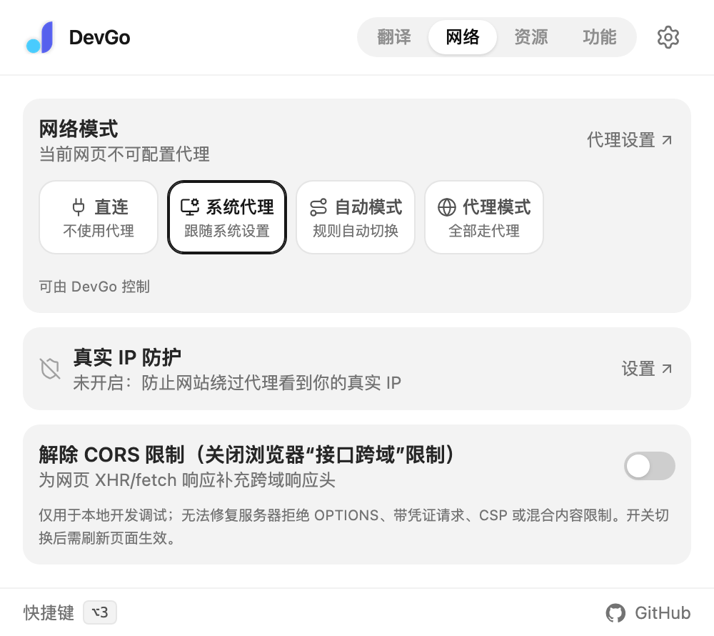

# CORS 调试

<!-- 适用版本：v0.2.3 -->

一句话：可开关地为网页的 XHR / fetch 响应补充跨域响应头，方便本地联调。

## 适用场景

本地开发时最常见的报错：前端 `localhost:5173` 直接请求另一个域名的接口，浏览器因为缺少 `Access-Control-Allow-Origin` 响应头把结果拦下来——接口明明通了，页面里就是读不到。

开这个开关后，DevGo 为网页的 XHR / fetch 响应补充跨域响应头，请求正常返回，前端不用改代码、不用配代理，先把逻辑调通。

## 怎么开

弹窗「网络」页 →「解除 CORS 限制」开关。开关切换后**刷新页面**生效。

_图：弹窗「网络」页——「解除 CORS 限制」开关在页面下方。_

<!-- TODO(manual)：弹窗「网络」页 CORS 卡片裁切图，路径 shots/0.2.3/zh-CN/light/popup-cors.png，落地后替换上图 -->

## 边界与注意

- 仅用于**本地开发调试**，别长期开着逛网页：它削弱的是浏览器的同源防护
- 救不了这些情况：服务器直接拒绝 OPTIONS 预检、需要携带凭证（Cookie）的请求、CSP 限制、混合内容（HTTPS 页面请求 HTTP 接口）——这些得从服务端或页面本身解决
- 与真实 IP 防护、代理模式互不影响，可以同时使用
