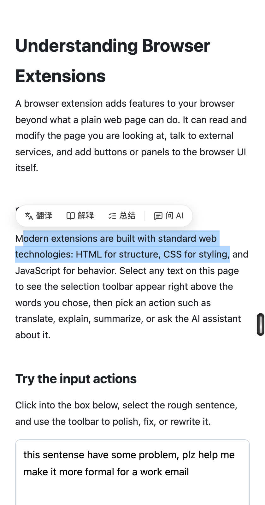

# 悬浮快捷栏

<!-- 适用版本：v0.2.3；配文：glm2 -->

一句话：网页右侧的深色悬浮条，悬停展开快捷操作——翻译本页 / 显示原文、AI 总结本页、AI 助手、回到顶部、设置；可以上下拖动，也可以按需关闭。

<!-- TODO(glm2)：三种关闭方式（本次不显示 / 本站不显示 / 全部不显示）及各自重新打开的位置（弹窗「功能」页、设置页「网页增强」）、贴边收起与呼吸动效说明 -->

