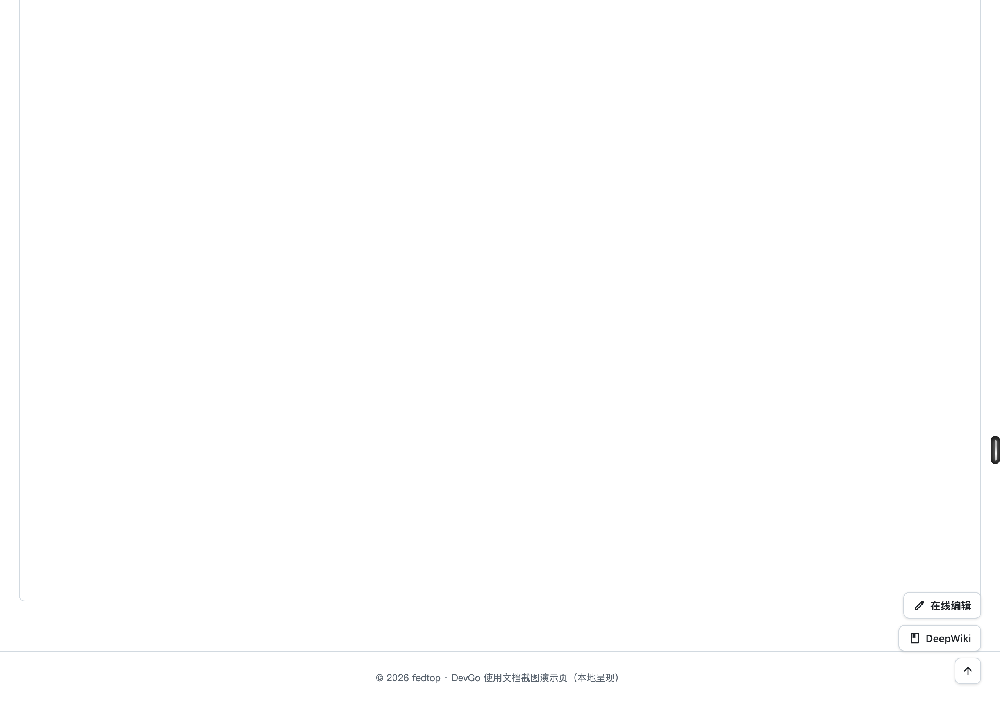

# GitHub 增强

<!-- 适用版本：v0.2.3 -->

一句话：GitHub 代码页悬浮按钮（在线编辑、DeepWiki、回到顶部），按 `,` 一键用 github1s 打开；GitHub 代码区不会被浏览器自动翻译干扰。

在设置页「网页增强 → GitHub 增强」可整体开关。

## 悬浮按钮

打开任意仓库的代码页（仓库首页、目录、文件页）时，页面右下角出现一列悬浮按钮：

| 按钮     | 作用                                                                                                         |
| -------- | ------------------------------------------------------------------------------------------------------------ |
| 在线编辑 | 在 [github1s](https://github1s.com) 打开当前仓库和路径——VS Code 界面的网页版代码浏览，比 github.dev 加载更快 |
| DeepWiki | 在 [deepwiki.com](https://deepwiki.com) 打开当前仓库的 AI 生成文档：架构、模块讲解，快速了解陌生项目         |
| 回到顶部 | 页面滚过一段距离后才出现                                                                                     |

仓库的 Issues、Pull Request、Actions 等子页面不显示按钮，不干扰正常浏览。

## 快捷键 `,`

在 GitHub 代码页的**非输入框**里按一下 `,`，直接用 github1s 打开当前仓库路径，和「在线编辑」按钮等效。（这也是 GitHub 官方 `.` 打开 github.dev 的习惯用法，`,` 对应更快的 github1s。）

## 代码区防误翻译

用浏览器自带翻译或 DevGo 整页翻译看外文 README 时，代码块容易被一起翻译弄坏。DevGo 会给 GitHub 代码区加上「不应翻译」标记，译文只作用于自然语言部分，代码保持原样。
