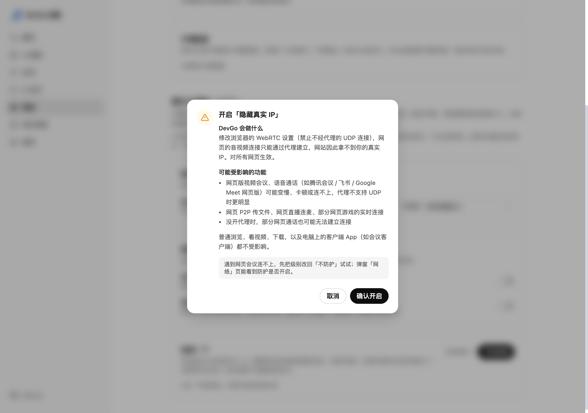
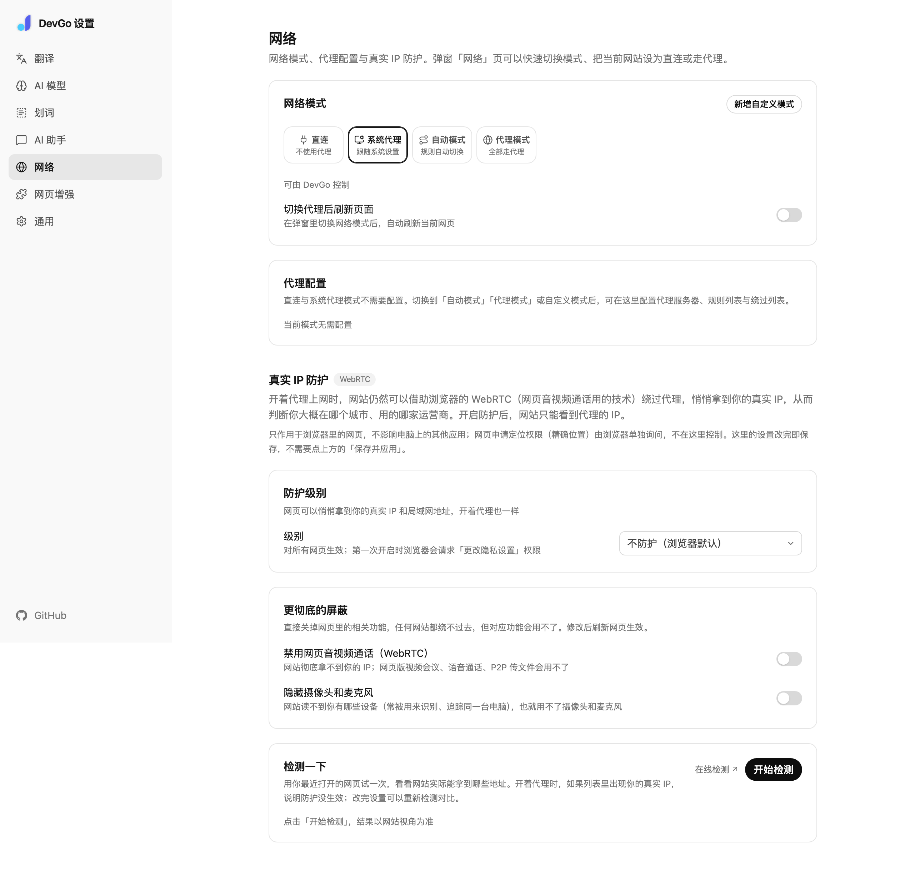
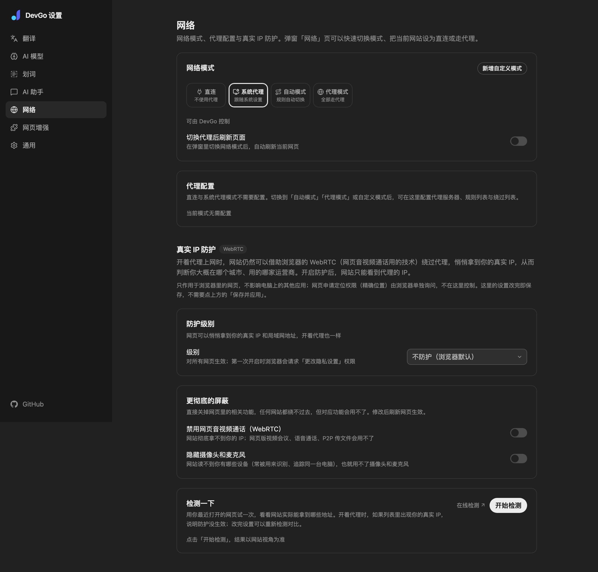

# 真实 IP 防护

<!-- 适用版本：v0.2.3 -->

一句话：开着代理上网时，网站仍可能借助 WebRTC 绕过代理拿到你的真实 IP，进而判断大致位置和运营商；开启防护后，网站只能看到代理的 IP。

## 先弄清它管什么

- **管**：浏览器里的网页借 WebRTC（网页音视频通话用的技术）绕过代理、悄悄探测你的真实 IP 和内网地址
- **不管**：电脑上的其他应用（App 走的不是浏览器）；网页申请 GPS 精确定位的权限由浏览器单独弹窗询问，也不在这里控制

开着代理时建议开启防护；不开代理时一般用不上。

## 防护级别

设置页「网络 → 真实 IP 防护」里选择：

| 级别                    | 效果                                 | 代价                                            |
| ----------------------- | ------------------------------------ | ----------------------------------------------- |
| 不防护（浏览器默认）    | 网页可以悄悄拿到真实 IP 和局域网地址 | 无                                              |
| 隐藏 VPN / 虚拟网卡     | 不暴露 VPN、虚拟机等额外网卡的地址   | 很小：仅能经 VPN / 虚拟网卡连通的通话可能连不上 |
| 隐藏局域网地址          | 网页看不到家里 / 公司内网地址        | 小：同一内网的网页通话、P2P 改走公网，可能稍慢  |
| **隐藏真实 IP（推荐）** | 开着代理时网页只能看到代理 IP        | 少数网页视频通话可能变慢或连不上                |

这里的设置改完即保存，不需要点上方的「保存并应用」。

## 开启确认弹窗：会改什么、影响什么

第一次选择防护级别（或打开下面的开关）时，DevGo 会先弹窗讲清三件事，点「确认开启」才会生效：

**① DevGo 实际做的事**（以「隐藏真实 IP」为例）：修改浏览器的 WebRTC 设置——禁止不经代理的 UDP 连接，网页的音视频连接只能通过代理建立，网站因此拿不到你的真实 IP。对所有网页生效。

**② 可能受影响的功能**：

- 网页版视频会议、语音通话（腾讯会议 / 飞书 / Google Meet 网页版等）可能变慢、卡顿或连不上，代理不支持 UDP 时更明显
- 网页 P2P 传文件、直播连麦、部分网页游戏的实时连接
- 没开代理时，部分网页通话也可能无法建立连接

弹窗会同时写明：**普通浏览、看视频、下载，以及电脑上的客户端 App（如会议客户端）都不受影响**。

**③ 出了问题怎么恢复**：遇到网页会议连不上，把级别改回「不防护」即可恢复；弹窗「网络」页能看到防护是否开启。

其他级别和开关的确认弹窗同理：「禁用网页音视频通话」会列出所有网页会议 / 语音通话 / 屏幕共享用不了；「隐藏摄像头和麦克风」会列出网页录音录像、拍照上传、语音输入、人脸核验会失效——每个弹窗底部都附有对应的恢复方法。

## 更彻底的屏蔽

级别之外还有两个独立开关，任何网站都绕不过去，但对应功能会直接用不了，修改后刷新网页生效：

- **禁用网页音视频通话（WebRTC）**：网页加载前移除 WebRTC 接口，网站彻底拿不到你的任何 IP；所有网页版会议、通话、P2P 传文件用不了
- **隐藏摄像头和麦克风**：屏蔽网页读取媒体设备的接口；网站读不到你有哪些设备（这类信息常被用来识别、追踪同一台电脑），摄像头麦克风也调用不了

## 检测一下

设置页内置「检测一下」：点「开始检测」，用你最近打开的网页实际探测一次，结果以**网站视角**列出它拿到的地址：

- **公网 IP**：开着代理时，这里应该是代理的 IP——出现你的真实 IP 就说明防护没生效
- **局域网地址**：内网地址，建议隐藏
- **本机地址（已匿名处理）**：浏览器自动做了 mDNS 匿名化，安全

改完设置可以重新检测对比。

## 权限与接管状态

- 第一次开启防护时，浏览器会请求「**更改隐私设置**」权限（`privacy` 是可选权限，只有开启时才申请）；若曾拒绝导致「还没授权」，重新选一次级别即可再次申请
- 防护状态显示当前浏览器生效的策略；若提示「被其他扩展接管」（如装了别的 WebRTC 类扩展）或「浏览器策略锁定」，DevGo 的设置不会生效，需要先处理冲突来源

## 弹窗里的状态

弹窗「网络」页始终显示防护是否开启：开着代理却未开启防护时，会用橙色提醒「网站仍可能看到你的真实 IP」，点击直达设置页。

