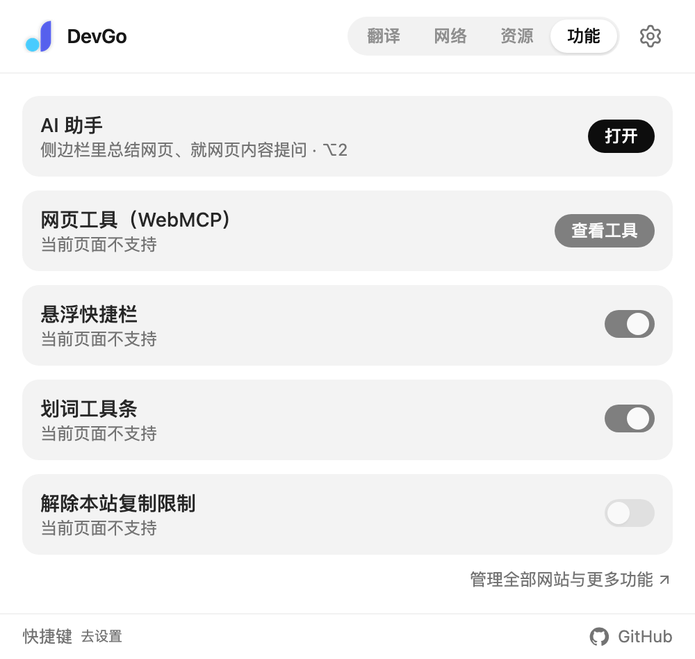
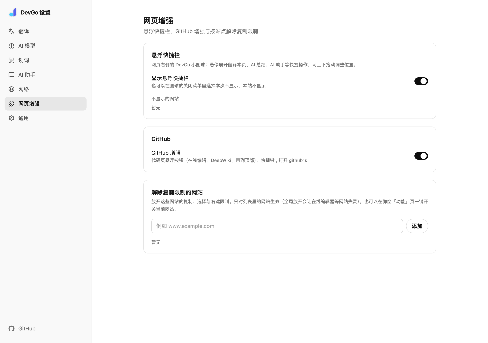

# 网页增强

<!-- 适用版本：v0.2.3 -->

一句话：按站点解除复制 / 选择 / 右键限制，管理悬浮快捷栏在各网站的显示，都能在弹窗「功能」页对当前网站一键开关。

弹窗「功能」页是这三个开关的统一入口，每个开关只影响当前网站，旁边会显示当前状态（如「已在 github.com 停用」「共 3 个站点已开启」）。

_图：弹窗「功能」页——三个按站开关显示当前网站状态。_

## 划词工具条

对当前网站显示 / 停用划词工具条。在线编辑器、本身就带划词功能的网站上容易误触，在这里关掉，其他网站照常使用。停用列表在设置页「划词 → 停用划词的网站」管理。详见[划词工具条](/features/selection-toolbar)。

## 悬浮快捷栏

对当前网站显示 / 隐藏悬浮快捷栏；设置页「网页增强」里还有总开关和「不显示的网站」列表。详见[悬浮快捷栏](/features/dock)。

## 解除本站复制限制

有些网站禁止复制、选择文字、右键（复制不了文档内容、看不到右键菜单）。开启后放开当前网站的这三类限制。

**为什么是按站点而不是全局**：全局放开会破坏在线编辑器等网站的正常行为，所以只对你加进列表的网站生效。需要哪个站开哪个：弹窗「功能」页一键开关，或在设置页「网页增强 → 解除复制限制的网站」里添加（每行一个域名，如 `www.example.com`）。

## 其他

弹窗「功能」页还有 AI 助手和网页工具（WebMCP）的快捷入口，见对应功能页；页面底部的「管理全部网站与更多功能」直达设置页。

_图：设置页「网页增强」——悬浮快捷栏总开关与解除复制限制的网站列表。_
