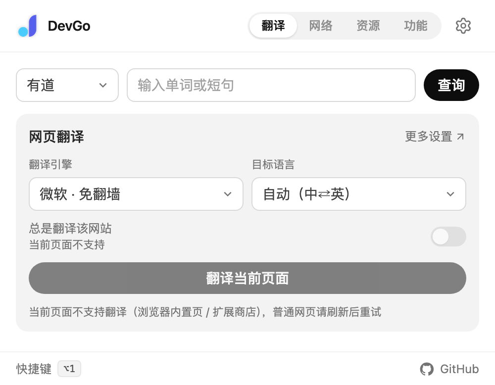
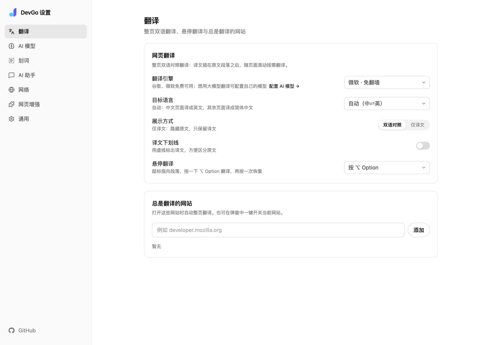

# 整页双语翻译

<!-- 适用版本：v0.2.3 -->

一句话：译文插在原文段落之后，随滚动按需翻译，再点一次还原；支持 Shadow DOM / Web Components 页面。

## 入口

- **弹窗**：`Alt+1` →「翻译」页 →「翻译当前页面 / 显示原文」
- **右键菜单**：页面空白处右键 →「翻译当前页面（再次点击恢复原文）」
- **悬浮快捷栏**：悬停网页右侧悬浮条 →「翻译本页 / 显示原文」
- **快捷键**：「整页行间翻译」默认未绑定，可在 `chrome://extensions/shortcuts` 自行设置
- **自动**：把常用站点加进「总是翻译的网站」，打开即自动翻译

## 翻译引擎

| 引擎          | 特点                                                                            |
| ------------- | ------------------------------------------------------------------------------- |
| 微软 · 免翻墙 | 默认。免费可用，国内网络直连                                                    |
| Google        | 翻译质量好，需要代理                                                            |
| AI 大模型     | 用你自己的模型翻译，质量与术语可控；需在[AI 模型](/settings/models)配置翻译模型 |

目标语言默认「自动」：中文页面译成英文，其余页面译成简体中文；也可以固定为 17 种语言中的任意一种。

## 展示方式

在设置页「翻译 → 网页翻译」里可调：

- **双语对照**（默认）：译文插在原文段落之后
- **仅译文**：隐藏原文，只保留译文，读起来更沉浸
- **译文下划线**：给译文加虚线，方便和原文区分

## 悬停翻译

不想整页翻？设置页「翻译」里可以开启**悬停翻译**，只翻鼠标下的段落：

| 模式                        | 用法                                                                 |
| --------------------------- | -------------------------------------------------------------------- |
| 按 `Alt` / `Ctrl` / `Shift` | 鼠标指向段落，按一下修饰键翻译，再按一次恢复（默认 Alt，macOS 为 ⌥） |
| 停留自动翻译                | 鼠标在段落上停留片刻自动翻译                                         |

## 总是翻译的网站

把 `developer.mozilla.org` 这类常读的外文站加进列表，打开就自动整页翻译。也可以在弹窗「翻译」页对当前网站一键开关。

## 注意事项

- 浏览器内置页（`chrome://` 开头）和扩展商店不支持翻译；普通网页如果刚装扩展就翻不了，刷新一次再试
- 长页面按需加载：滚动到哪翻到哪，失败段落后面有 ↻ 可以单独重试
- 选 AI 大模型翻译时，建议选不带深度思考的快模型（如 glm-4-flash、qwen-turbo），整页翻译更跟手

