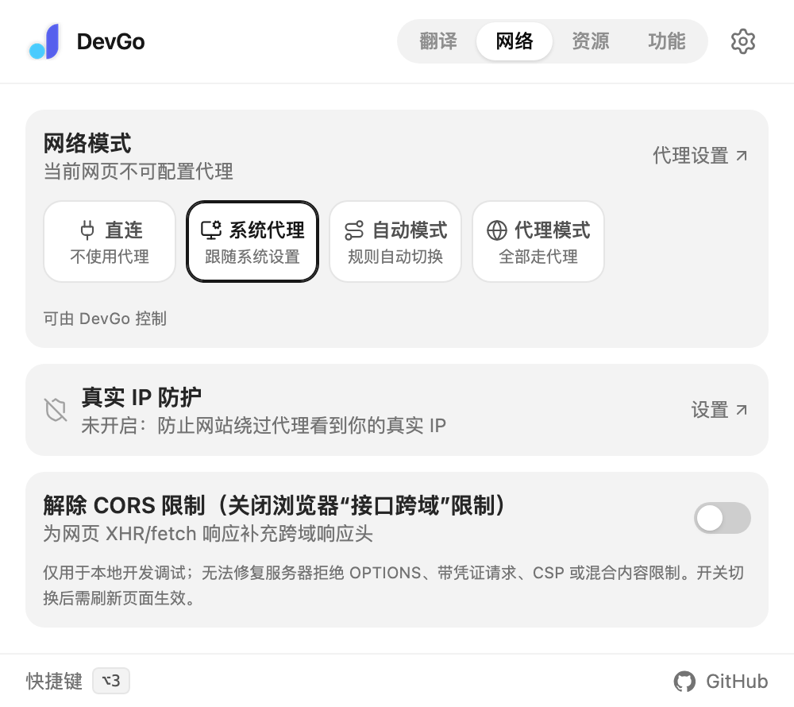
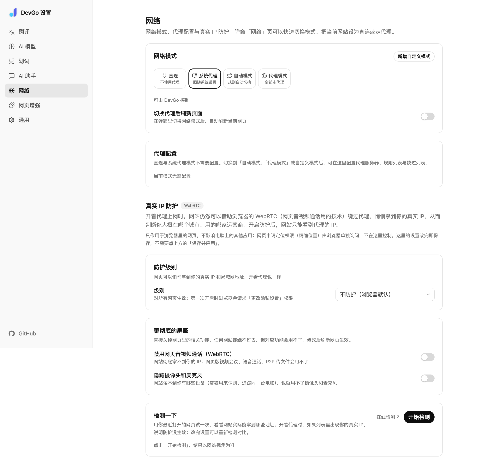

# 代理与自动分流

<!-- 适用版本：v0.2.3；配文：glm2 -->

一句话：直连 / 系统代理 / 自动模式 / 代理模式一键切换，也可以新增自定义代理模式；每种模式分别保存代理服务器和绕过列表。

<!-- TODO(glm2)：自动模式（AutoProxy / GFWList 规则每 6 小时更新、自定义代理域名、未命中规则时的默认去向）、切换代理后是否自动刷新页面、注意事项（仅 Chromium 生效，Firefox 见 FAQ） -->

