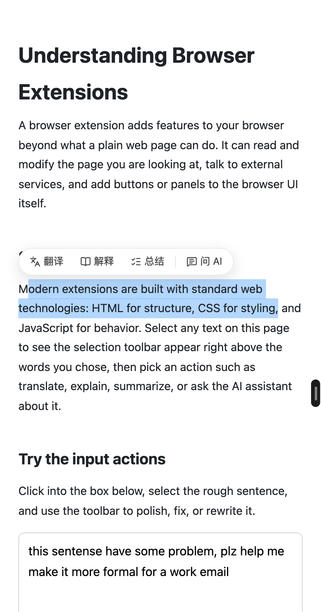
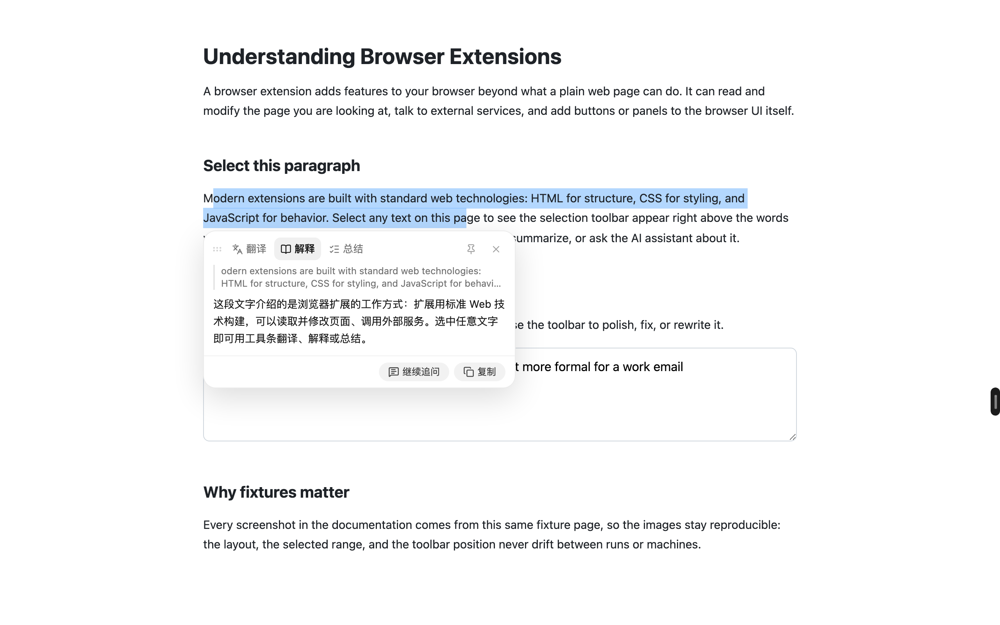
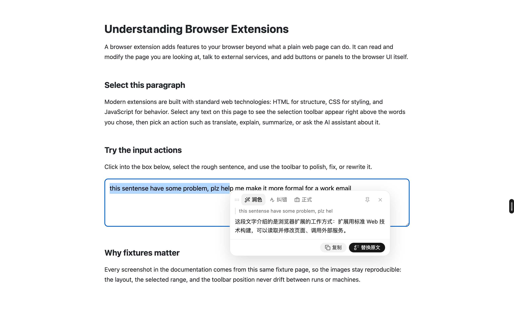

# 划词工具条与自定义动作

<!-- 适用版本：v0.2.3 -->

一句话：选中网页文字，上方浮出工具条——翻译、解释、总结、问 AI；在输入框里选中文字可以用 AI 润色、纠错、改正式并一键替换原文。

## 网页文字上

选中文字后浮出的工具条：

- **翻译**：翻译选中文本；选中单个英文单词时，同时显示词典释义
- **解释 / 总结**：AI 结合所在段落和网页标题解释、提炼选中内容
- **问 AI**：打开侧边栏，带着选中内容继续追问
- 动作超过 4 个时收进「更多」下拉菜单

_图：网页文字上的划词工具条。_

结果面板贴在选中文字下方，页面滚动时跟着走；可以点图钉**固定**在屏幕上，也可以拖动。底部支持**复制、继续追问、重试**。

_图：划词「解释」的结果面板——顶部切换动作，底部可继续追问或复制。_

## 输入框里

在输入框（评论框、搜索框、网页编辑器）里选中文字，工具条变成写作模式：**润色、纠错、正式**，以及你添加的适用范围包含「输入框」的自定义动作。AI 处理完点「替换原文」，输入框内容直接替换成结果。

_图：输入框里的写作模式——AI 润色后点「替换原文」，输入框内容直接替换成结果。_

## 自定义动作

内置动作不够用时，在设置页「划词 → 工具条动作 → 新增动作」添加：

- **名称**：显示在工具条上，如「译成英文」
- **图标**：从 12 个常用图标里选
- **适用范围**：网页文字 / 输入框 / 两者都适用
- **提示词**：告诉 AI 怎么处理选中内容，如「把选中的内容整理成 JSON，只输出 JSON 本身」

不用自己拼上下文——和内置动作一样，请求会自动附带选中内容所在的段落和网页标题。

自带三个示例模板，一键添加：**译成英文**、**解释报错**、**转 JSON**。

管理区还支持：编辑、删除（有确认）、上移 / 下移排序，内置动作也可以逐个隐藏。工具条最多直接显示 4 个动作，其余收进「更多」。

_图：设置页「划词 → 工具条动作」——内置动作开关、自定义动作管理与示例模板。_

## 开关与停用

- **全局开关**：设置页「划词 → 启用划词」；「AI 动作」也可以单独关掉（只留翻译）
- **按网站停用**：弹窗「功能」页 →「划词工具条」开关只管当前网站，关掉后提示「已在 xxx 停用」；停用列表在设置页「停用划词的网站」里管理

## 注意事项

- 解释、总结等 AI 动作需要先配置[对话模型](/settings/models)（未单独配置时沿用翻译模型）。还没配置模型或 API Key 时，结果面板会提示去配置，点「**去配置**」直达设置页「AI 模型」；Key 无效（401 / 403）时同样会出这个按钮
- 只想关掉某一个网站（比如在线编辑器）时，用按站停用，不用关全局
- 自定义动作参与[备份导出 / 导入](/settings/sync)，换机不丢
