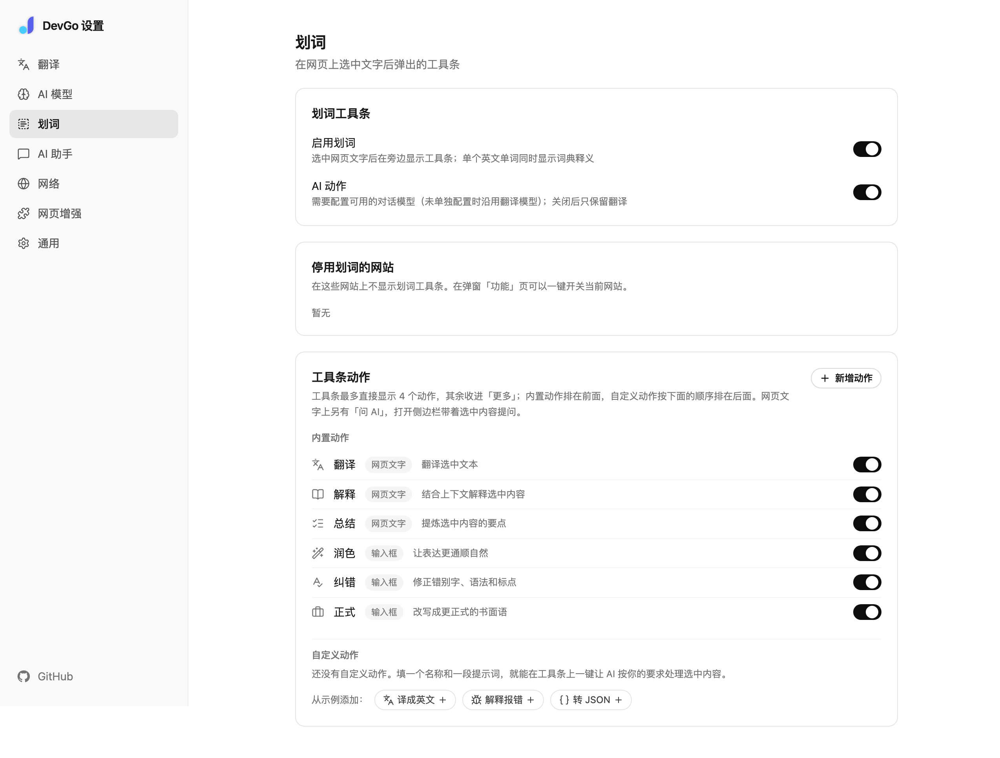

# 划词工具条与自定义动作

<!-- 适用版本：v0.2.3；配文：glm2 -->

一句话：选中网页文字，上方浮出工具条——翻译、解释、总结、问 AI；在输入框里选中文字可以用 AI 润色、纠错、改正式并一键替换原文。

<!-- TODO(glm2)：自定义动作（设置页「划词 → 工具条动作」：名称 + 提示词 + 图标 + 适用范围，示例模板）、按站点停用（弹窗「功能」页）、「更多」菜单 -->

