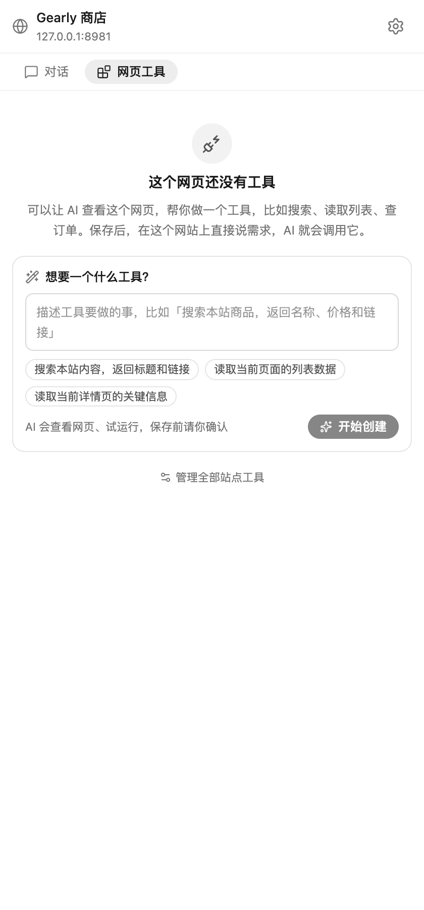
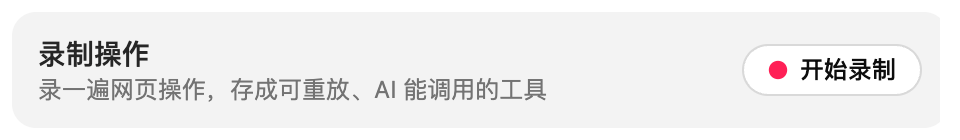
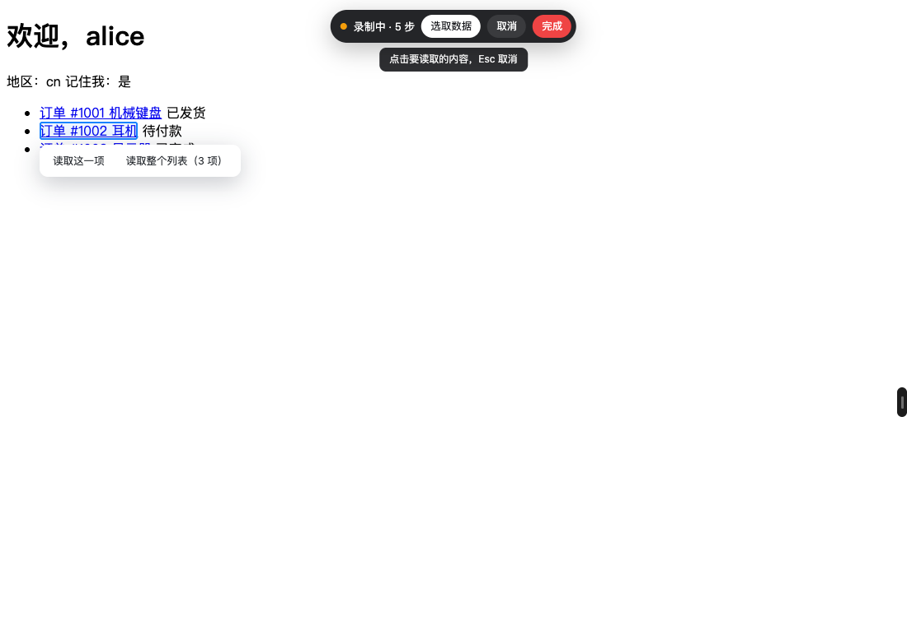
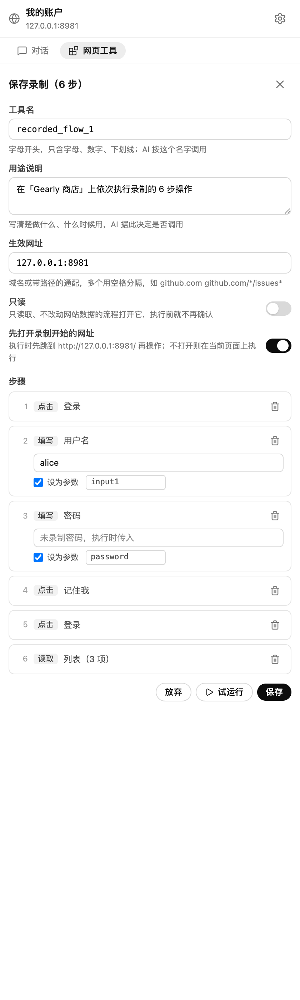
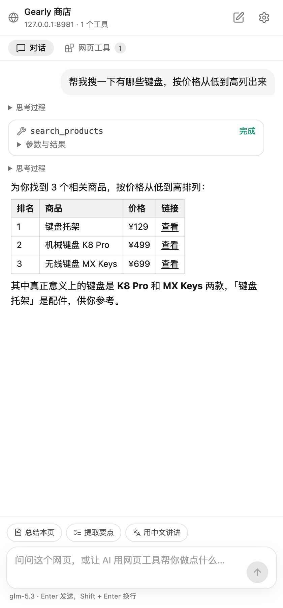
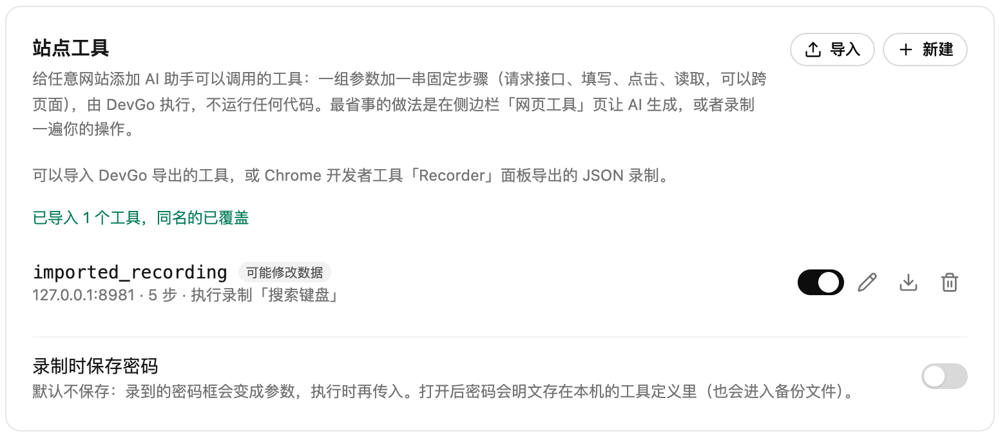

# 站点工具与录制操作

<!-- 适用版本：v0.2.5 -->

一句话：给任意网站加上 AI 助手能调用的工具，比如「搜索本站商品」「读取订单列表」「填好表单并提交」。可以让 AI 看着网页帮你生成，也可以把自己的操作录一遍；保存后既能一键重放，也能在对话里让 AI 自动调用。

和[网页工具（WebMCP）](/features/webmcp)的区别：WebMCP 工具是网站自己提供的，绝大多数网站还没有；站点工具是你自己给网站加的，任何网站都能用，也不需要开启浏览器的实验功能。

## 方式一：让 AI 生成

1. 打开想增强的网站，打开侧边栏（`Alt+2`），切到「**网页工具**」页
2. 当前网站还没有工具时，页面上直接就是「想要一个什么工具？」输入框；已经有工具时点「**用 AI 新建工具**」
3. 描述需求，或者点下面的示例（「搜索本站内容，返回标题和链接」「读取当前页面的列表数据」等），点「**开始创建**」
4. 对话里能看到 AI 的过程：**查看网页结构** → 写出工具 → **试运行**，出错会自己修正
5. 保存前会弹出确认卡片，展示完整的工具定义，你点「允许执行」才会保存

_图：「网页工具」页——没有工具时直接描述需求，让 AI 创建。_

也可以直接在「对话」里说「给这个网站做一个搜索工具」，效果一样。

## 方式二：录制操作

适合「点这里、选那个、填好再提交」这类流程化操作——你亲手做一遍，步骤是确定的，不依赖 AI，没配置模型也能用。

**开始录制**：弹窗「功能」页的「**录制操作**」点「开始录制」，或者侧边栏「网页工具」页点「**录制操作**」。

_图：弹窗「功能」页的「录制操作」入口。_

**录制中**：网页顶部出现录制条，正常操作网页即可：

- 点击、输入、勾选、下拉选择、回车都会被记录；同一个输入框连续输入只记最终的值
- 跳转到其他页面也会接着录（如「首页 → 登录页 → 账户页」）
- 想让工具返回数据时，点录制条上的「**选取数据**」，再点页面上要读的内容，选择「读取这一项」或「读取整个列表（N 项）」——同类的列表项会自动识别
- 点「**完成**」结束（也可以在弹窗里点「完成录制」），点「取消」放弃

_图：录制条与「选取数据」——点中订单列表的一项，可以读取这一项或整个列表。_

**整理保存**：录完侧边栏会打开整理页：

- 每个填写的值旁边可以勾「**设为参数**」，下次执行就能换成别的值（如搜索关键词、用户名）
- 改工具名、用途说明（AI 据此判断什么时候调用）和生效网址
- 「**只读**」：只读取、不改动网站数据的流程打开它，执行前就不再确认（默认关）
- 「**先打开录制开始的网址**」：每次执行先跳到录制起点再操作（默认关，在当前页面上执行）
- 多余的步骤可以删掉；点「**试运行**」验证（试运行总是先回到录制开始的网址），再「**保存**」

_图：录制整理页——用户名设为参数，密码没有录下、执行时传入。_

### 密码

默认**不录密码**：录到的密码框会自动变成参数，执行时再传入。如果为了方便确实想把密码存下来，在设置页「AI 助手 → 站点工具」打开「**录制时保存密码**」——打开后密码会明文存在本机的工具定义里，也会进入备份导出文件，请自行权衡。

## 使用工具

- **让 AI 调用**：在这个网站上直接说需求，比如「帮我搜一下有哪些键盘，按价格从低到高列出来」，AI 会自动调用匹配当前网址的站点工具
- **手动执行**：侧边栏「网页工具」页里，站点工具带「站点工具」标签，展开卡片填参数、点「执行」

_图：对话里 AI 调用站点工具，结果整理成表格。_

会修改数据的工具（没标只读的）执行前会弹卡片让你确认，和网页工具的确认是同一个开关（设置页「AI 助手」）。

## 管理、导入与导出

设置页「**AI 助手 → 站点工具**」里列出全部站点工具，可以：

- 启用 / 停用、编辑（JSON）、删除
- **导出**单个工具为 JSON 文件，分享给别人
- **导入** DevGo 导出的工具，或 **Chrome 开发者工具「Recorder」面板**导出的 JSON 录制——已有的录制可以直接变成站点工具

站点工具会随[备份](/settings/sync)一起导出 / 导入。

_图：设置页「站点工具」——导入 / 导出、启停与「录制时保存密码」开关。_

## 工作原理与限制

- 工具是**纯数据**：一组参数加一串固定步骤（请求接口、填写、按键、点击、等待、读取、打开网址），由 DevGo 内置的执行器执行，**不运行任何代码**，不需要额外权限，GitHub 这类安全策略严格的网站也能用
- 每个元素会记下 3–5 个候选选择器（按名称、属性、文字、路径），网站小改版时会自动换用备选；点击、填写前会自动等待元素出现
- 支持跨页面：点击或打开网址导致页面跳转后，等新页面加载完再继续后面的步骤
- 扩展刚安装或更新、网页还没刷新时也能直接执行，不用手动刷新
- 暂不支持：iframe 内的元素、拖拽 / 悬停 / 滚动；网站大改版后选择器可能失效，这时让 AI「修一下这个工具」，或重新录制
- 生效网址写域名（`github.com`，含子域名）或带路径的通配（`github.com/*/issues*`），只在匹配的网站上出现
