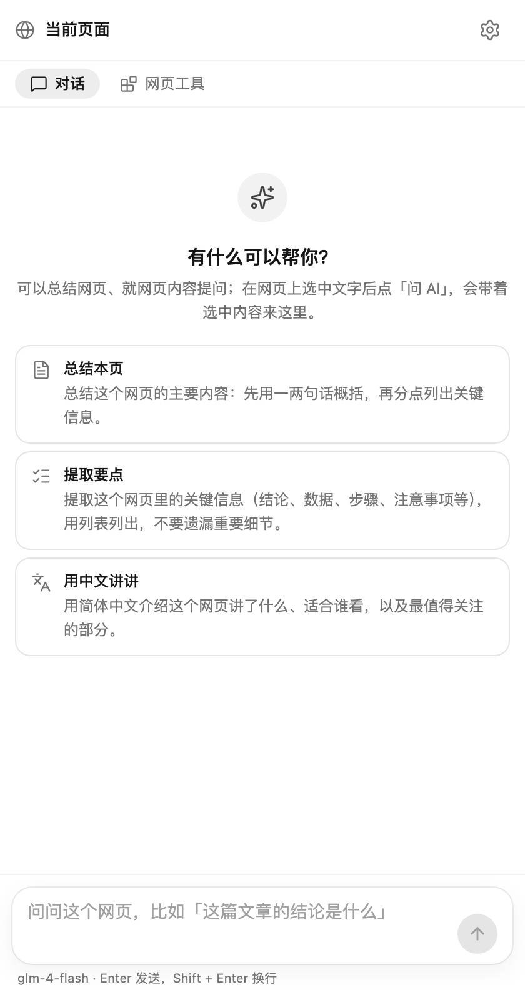

# 网页工具（WebMCP）

<!-- 适用版本：v0.2.3；配文：glm2 -->

一句话：自动列出网页通过 WebMCP 注册的工具（含 iframe），AI 可以调用它们完成任务；侧边栏「网页工具」页可以查看每个工具的说明并手动执行（方便调试网页的 WebMCP 实现）。

<!-- TODO(glm2)：前置条件（Chrome 150+ 并在 chrome://flags 开启 WebMCP for testing）、只读与可能修改数据的区别、执行前确认 -->

<!-- TODO：网页工具页截图需要 WebMCP 测试页环境，归入 manual 人工补充：shots/0.2.3/manual/webmcp.png -->
