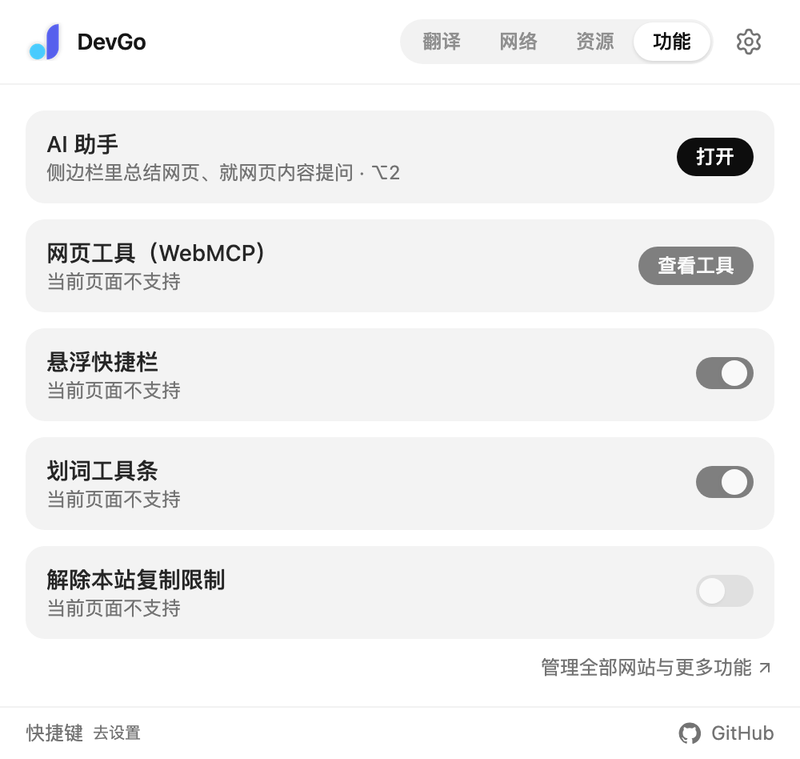

# DevGo 是什么

<!-- 适用版本：v0.2.3；配文：glm2 -->

DevGo 是一个面向开发者的浏览器效率扩展，聚焦翻译、GitHub 增强、新标签页效率工具与页面调试辅助能力。支持 Chrome 与 Firefox，界面中英双语。

<!-- TODO(glm2)：一段话定位 + 核心能力清单 + 各功能一屏概览图 -->

## 相关链接

- [Chrome 应用商店](https://chrome.google.com/webstore/detail/devgo/kcofdbjhicjdbmldlcffcijglkifnnjn)
- [GitHub 仓库](https://github.com/fedtop/DevGo)
- [GitHub Releases 离线安装包](https://github.com/fedtop/DevGo/releases)
