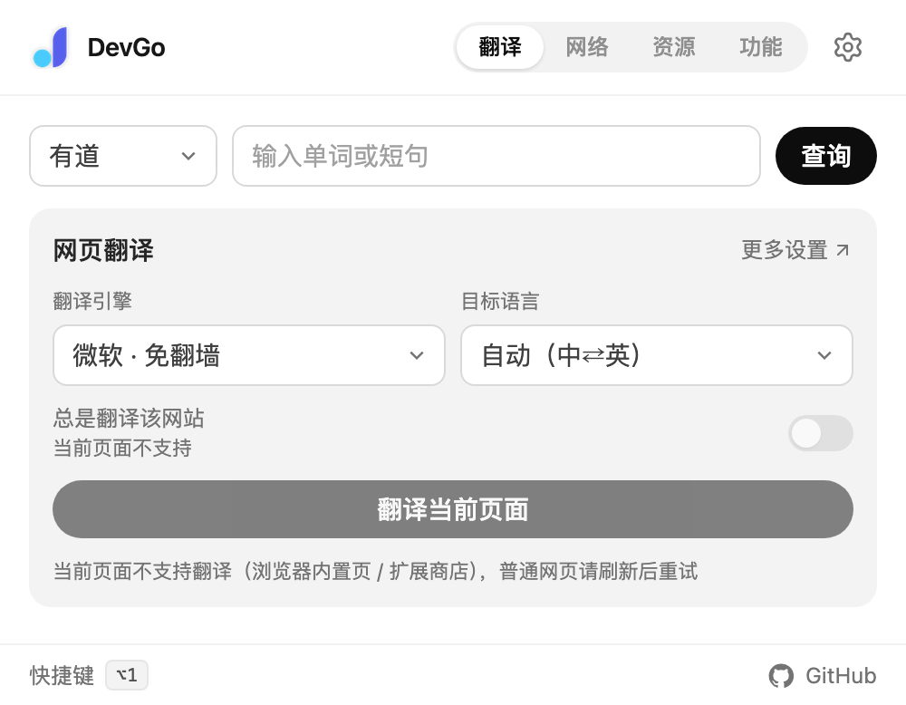

# 快速上手（5 分钟）

<!-- 适用版本：v0.2.3；配文：glm2 -->

装好 DevGo 后，先做这三件事，最核心的能力就都用上了。

<!-- TODO(glm2)：按「一句话作用 → 入口在哪 → 图 → 注意事项」展开三步 -->

## 1. 整页双语翻译

打开任意外文网页，点工具栏里的 DevGo 图标 →「翻译」页 →「翻译当前页面」，译文会插在原文段落后面，边读边对照；再点一次恢复原文。

## 2. 划词翻译与 AI 动作

在网页里选中一段文字，文字上方会浮出工具条：翻译、解释、总结、问 AI，还可以在设置里添加自己的动作（比如「转成 JSON」「写单测」）。

## 3. 悬浮快捷栏

网页右侧的悬浮球，悬停即可展开：翻译本页、AI 总结本页、AI 助手、回到顶部。觉得碍事可以关掉——支持本次不显示、本站不显示、全部不显示。

## 下一步

- 配置 [AI 模型](/settings/models)，解锁 AI 解释、总结与侧边栏助手
- 了解[代理与真实 IP 防护](/features/ip-protection)
