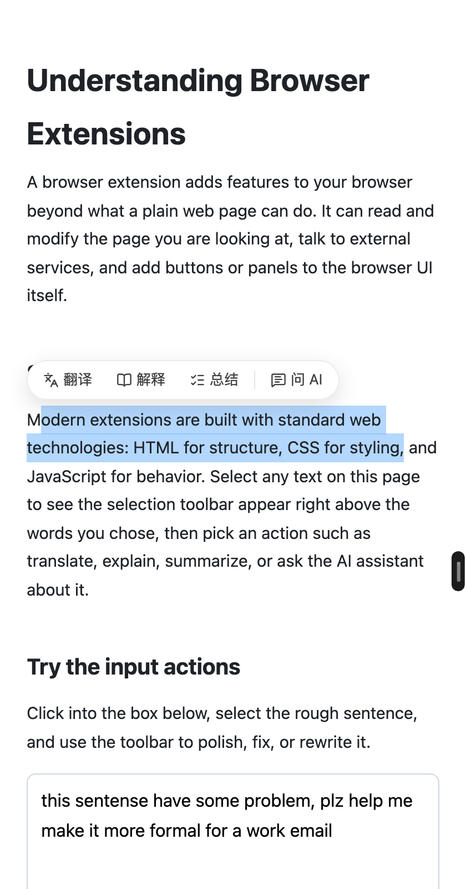
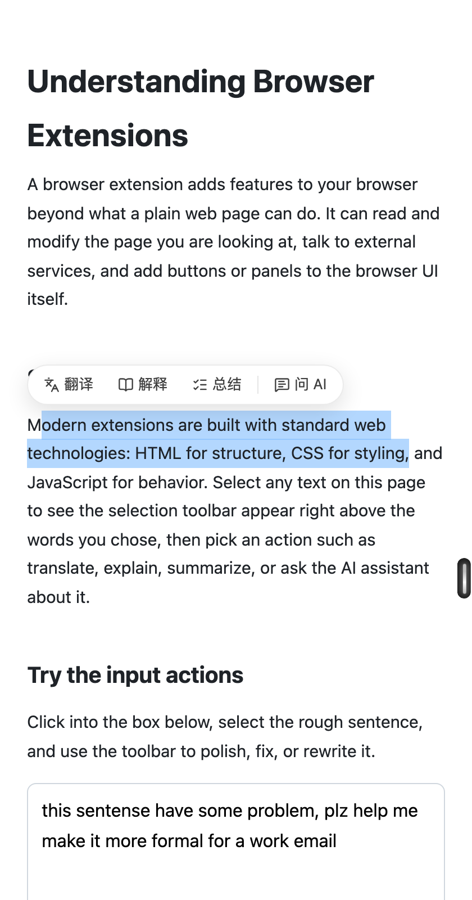

# 快速上手（5 分钟）

<!-- 适用版本：v0.2.3 -->

装好 DevGo 后，先做这三件事，最核心的能力就都用上了。

## 1. 整页双语翻译

**作用**：把整个网页翻译成你的语言，译文插在原文段落后面，边读边对照。

**怎么做**：打开任意外文网页，任选其一——

- 点工具栏 DevGo 图标 →「翻译」页 → 点「翻译当前页面」
- 在页面空白处右键 →「翻译当前页面（再次点击恢复原文）」
- 在 `chrome://extensions/shortcuts` 给「整页行间翻译」绑定快捷键后一键切换

译文随滚动按需加载，长页面不用等全页翻完；再点一次「显示原文」即恢复。

::: tip
引擎默认是微软翻译（免翻墙），也可切换 Google 或自己的 AI 大模型，见[整页双语翻译](/features/page-translate)。
:::

## 2. 划词翻译与 AI 动作

**作用**：选中一段文字，上方浮出工具条，不用跳转页面。

**怎么做**：在网页里选中文字——

- 网页文字：**翻译 / 解释 / 总结 / 问 AI**，选中单个英文单词还会并行显示词典释义
- 输入框里的文字：**润色 / 纠错 / 正式**，AI 处理完可一键「替换原文」
- 工具条动作不够用？在设置页「划词 → 工具条动作」添加自己的动作（如「转 JSON」「解释报错」），填名称和提示词即可

::: tip
解释、总结等 AI 动作需要先配置模型，见 [AI 模型](/settings/models)。觉得工具条碍事？弹窗「功能」页可只对当前网站停用。
:::

## 3. 悬浮快捷栏

**作用**：网页右侧贴边的深色悬浮条，悬停展开常用操作。

**怎么做**：把鼠标移到网页右侧边缘——

- **翻译本页 / 显示原文**：一键切换整页翻译
- **AI 总结本页**：打开侧边栏并自动开始总结
- **AI 助手**：打开侧边栏对话
- **回到顶部**：页面滚过一段距离后才出现

悬浮条可以上下拖动；点左上角 × 可以选择「本次不显示 / 在本站不显示 / 全部网站都不显示」。

## 默认快捷键

| 快捷键                | 作用                                                      |
| --------------------- | --------------------------------------------------------- |
| `Alt+1`（macOS `⌥1`） | 打开弹窗（默认页）                                        |
| `Alt+2`（macOS `⌥2`） | 打开 / 关闭侧边栏 AI 助手                                 |
| `Alt+3`（macOS `⌥3`） | 打开弹窗「网络」页                                        |
| `Alt+4`（macOS `⌥4`） | 打开弹窗「资源」页                                        |
| 未绑定                | 整页行间翻译（可在 `chrome://extensions/shortcuts` 绑定） |

所有快捷键都可以自定义，见[通用与外观](/settings/general#快捷键)。

## 下一步

- 配置 [AI 模型](/settings/models)，解锁 AI 解释、总结、润色与侧边栏助手
- 开着代理上网？看看[真实 IP 防护](/features/ip-protection)
- 想让 AI 直接操作网页？了解 [网页工具（WebMCP）](/features/webmcp)
