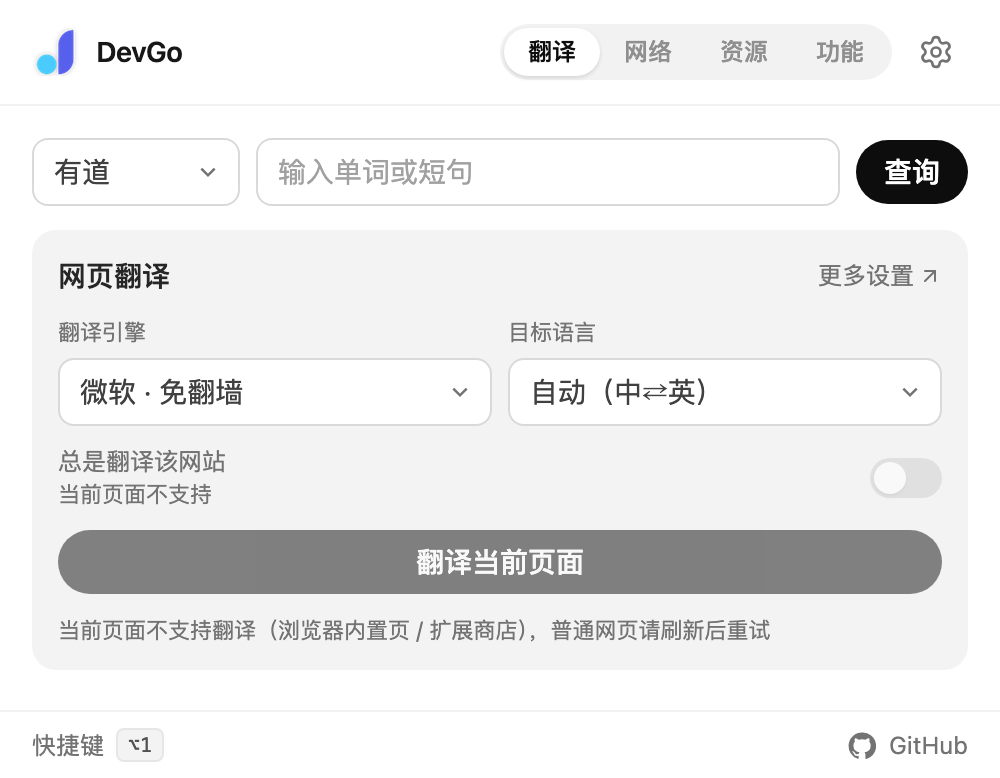

## 按需直达

**想解决翻译问题？** → [快速上手](/guide/quick-start) → [整页双语翻译](/features/page-translate) → [划词工具条与自定义动作](/features/selection-toolbar)

**开发者效率？** → [AI 助手](/features/assistant) → [网页工具（WebMCP）](/features/webmcp) → [CORS 调试](/features/cors) → [GitHub 增强](/features/github)

**隐私与网络？** → [代理与自动分流](/features/proxy) → [真实 IP 防护](/features/ip-protection)

遇到问题先看 [FAQ 与故障排查](/faq/)。
