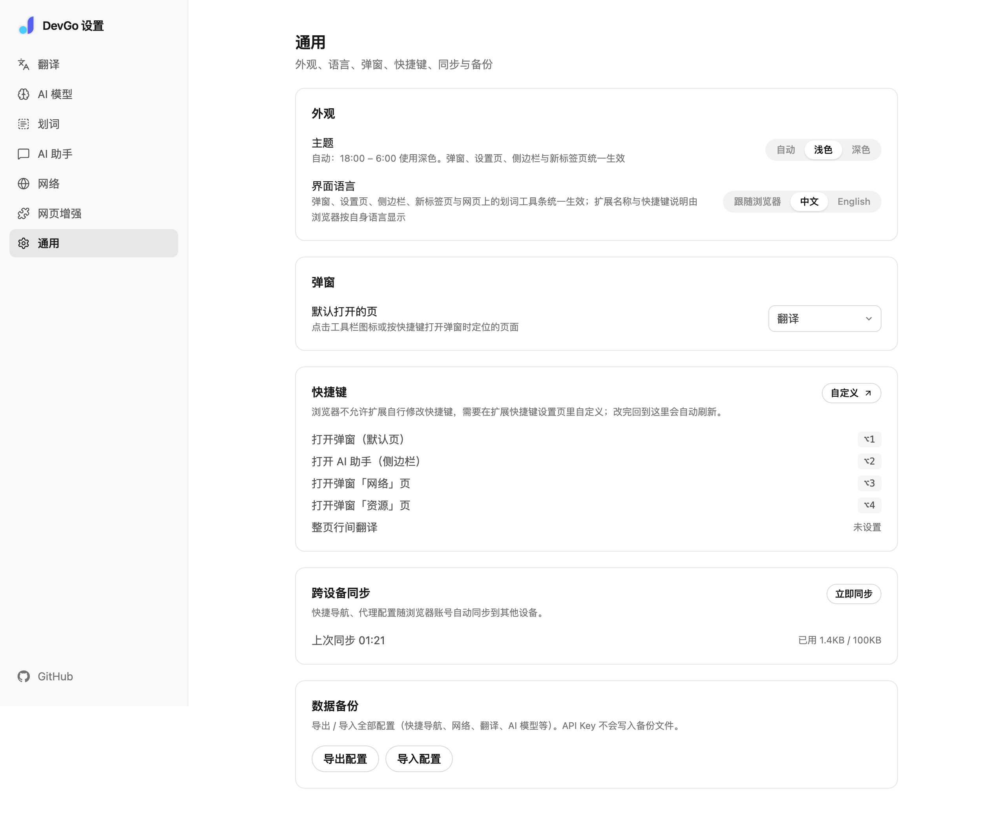
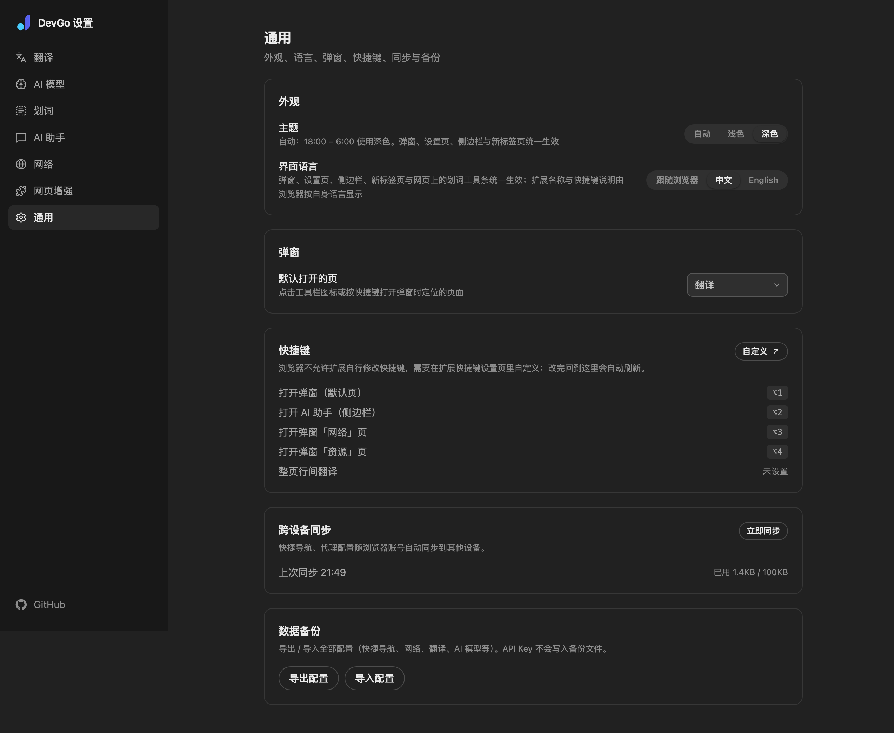

# 通用与外观

<!-- 适用版本：v0.2.3 -->

一句话：主题、界面语言、弹窗默认页、快捷键、跨设备同步与数据备份，都在设置页「通用」里。

## 外观

- **主题**：浅色 / 深色 / 自动。自动指 18:00 – 6:00 使用深色；弹窗、设置页、侧边栏与新标签页统一生效
- **界面语言**：跟随浏览器 / 中文 / English。切换立即生效，已经打开的页面不用刷新；扩展名称和快捷键说明由浏览器按自身语言显示（读的是 manifest，手动切换管不到）

_图：设置页「通用」——外观、语言、快捷键、同步与备份。_

_图：深色主题下的通用设置。_

## 弹窗

**默认打开的页**：点工具栏图标或按 `Alt+1` 打开弹窗时定位到哪一页（翻译 / 网络 / 资源 / 功能）。网络和资源还有专属快捷键 `Alt+3` / `Alt+4`。

## 快捷键

| 命令                   | 默认键                 |
| ---------------------- | ---------------------- |
| 打开弹窗（默认页）     | `Alt+1`                |
| 打开 AI 助手（侧边栏） | `Alt+2`（Chrome 专有） |
| 打开弹窗「网络」页     | `Alt+3`                |
| 打开弹窗「资源」页     | `Alt+4`                |
| 整页行间翻译           | 未绑定，可自行绑定     |

浏览器不允许扩展自行修改快捷键：

- **Chrome / Edge**：在 `chrome://extensions/shortcuts` 里改，改完回到设置页会自动刷新显示
- **Firefox**：`about:addons` 右上角齿轮 →「管理扩展快捷键」

## 跨设备同步

快捷导航、代理配置会随浏览器账号自动同步到其他设备（Chrome 同步空间上限 100KB，这里会显示用量）。「立即同步」手动触发一次，同时显示上次同步时间。

## 数据备份

**导出配置**生成 JSON 文件（快捷导航、网络、翻译、AI 模型、划词动作等全部设置）；**导入配置**恢复。API Key **不会**写入备份文件，换机后需要重新填写。详见[备份与同步](/settings/sync)。
