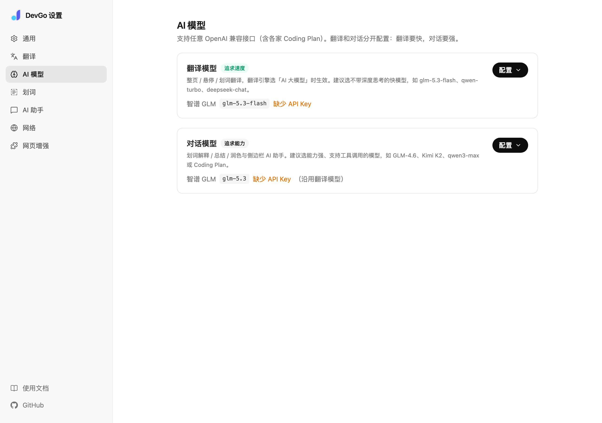

# AI 模型

<!-- 适用版本：v0.2.5 -->

一句话：翻译引擎可选谷歌、微软（免翻墙）或任意 OpenAI 兼容大模型；翻译模型与对话模型分开配置——翻译选快的，解释和助手选强的。

## 两个模型，各管一摊

| 配置         | 用在哪                                              | 怎么选                                                                            |
| ------------ | --------------------------------------------------- | --------------------------------------------------------------------------------- |
| **翻译模型** | 整页 / 悬停 / 划词翻译（引擎选「AI 大模型」时生效） | 追求速度：不带深度思考的快模型，如 glm-5.3-flash、qwen-turbo、deepseek-chat       |
| **对话模型** | 划词解释 / 总结 / 润色、侧边栏 AI 助手              | 追求能力：支持工具调用的强模型，如 glm-5.3、Kimi K2、qwen3-max 或各家 Coding Plan |

对话模型默认沿用翻译模型的服务和 Key，单独保存过配置后独立生效；不想维护两套时可以「改回沿用翻译模型」。

沿用时，如果翻译用的是预设推荐的快模型，对话会自动换成该服务推荐的强模型（如智谱：翻译 glm-5.3-flash、对话 glm-5.3）；你自己选过别的模型则保持不变。给对话模型选预设时，也会直接填上推荐的强模型。

_图：设置页「AI 模型」——翻译模型与对话模型分开配置。_

## 配置项

三样东西：

1. **服务预设**：智谱 GLM、智谱 / Z.ai / 阿里云百炼 / 火山方舟各家 Coding Plan、通义千问、豆包、Ollama（本地）或自定义。选预设会自动填好接口地址
2. **接口地址（Base URL）**：填到 `/v1` 即可，自动补全 `/chat/completions`
3. **API Key**：仅存本机，**不进备份导出**；本地 Ollama 可留空（需设置环境变量 `OLLAMA_ORIGINS=chrome-extension://*` 允许扩展访问）

**模型**一栏填好地址和 Key 后可以从列表选择（也支持自动获取模型列表）；「测试连接」一键验证配置是否可用。

## 自定义要求（可选）

可以给翻译和助手分别追加系统提示词：

- 翻译：当术语表用，如「技术文档风格；Token 不翻译」
- 助手：定回答风格，如「回答尽量简短」「操作前先列出步骤」

## 注意事项

- Coding Plan 套餐 Key 只能配合专属接口地址使用；部分套餐条款限定在编程工具中使用，请留意
- 火山方舟的模型名填控制台里的模型 ID 或推理接入点 ID（`ep-xxxx`）
- 提示词会自动附带选中内容的段落上下文和网页标题，不用自己写进「自定义要求」
