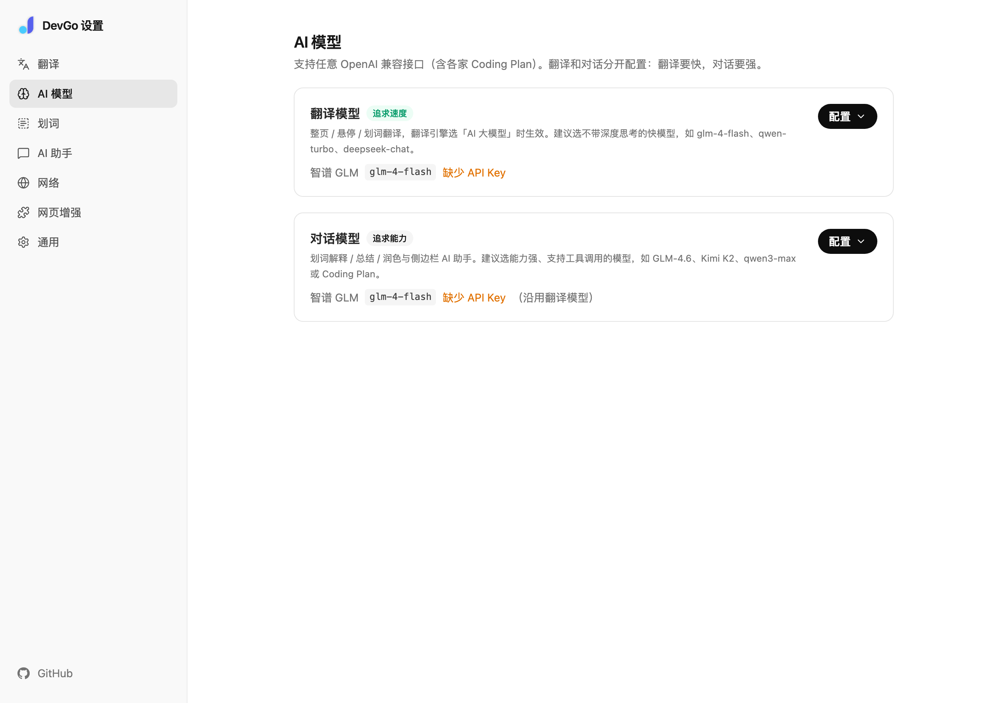

# AI 模型

<!-- 适用版本：v0.2.3；配文：glm2 -->

一句话：翻译引擎可选谷歌、微软（免翻墙）或任意 OpenAI 兼容大模型；翻译模型与对话模型分开配置——翻译选快的，解释和助手选强的。

<!-- TODO(glm2)：各预设（Coding Plan / MiniMax 等）、Base URL / API Key / 模型获取方式、API Key 不进备份导出的说明 -->

